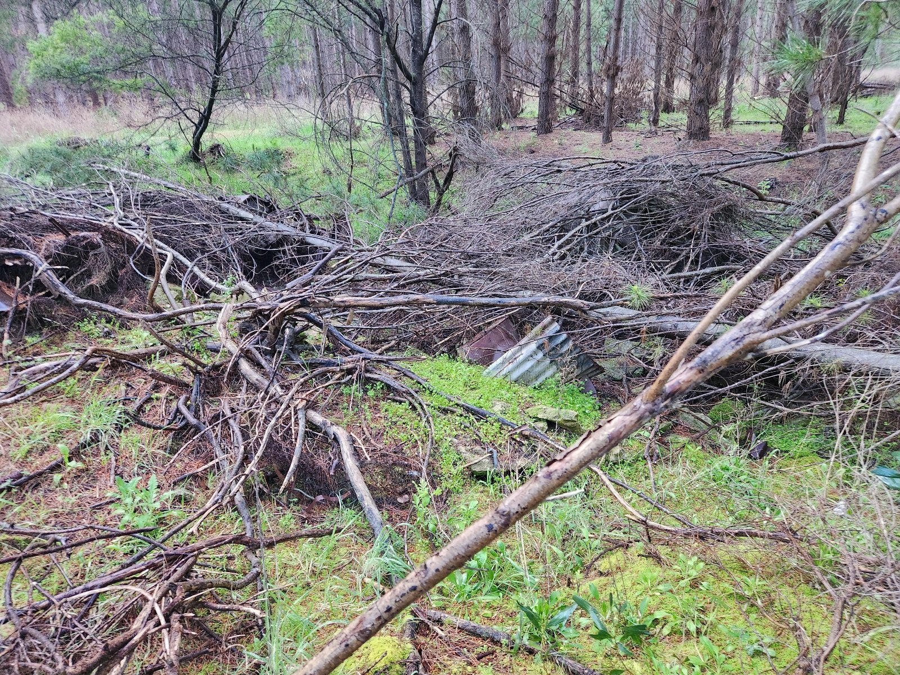
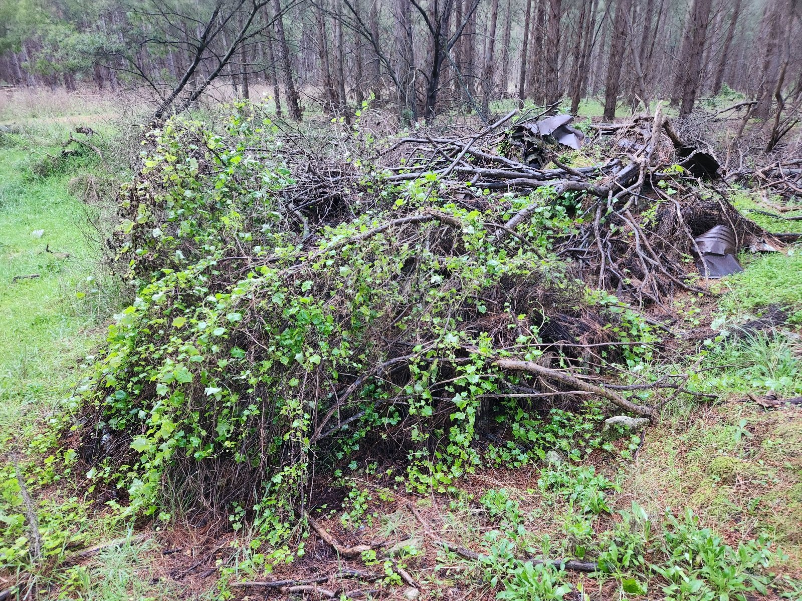
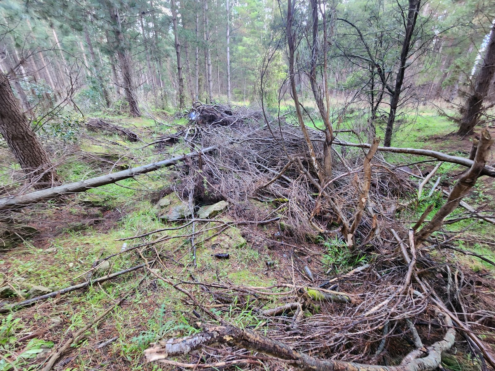

# About

BC 8/9/2023: Clear depression with some rocky features but buried under rubbish and brush

# Details

## Identification

- **Feature type:** Depression

## Cave and exploration data

- **Exploration potential:** Low

# References

## Images
- 
- 
- 
