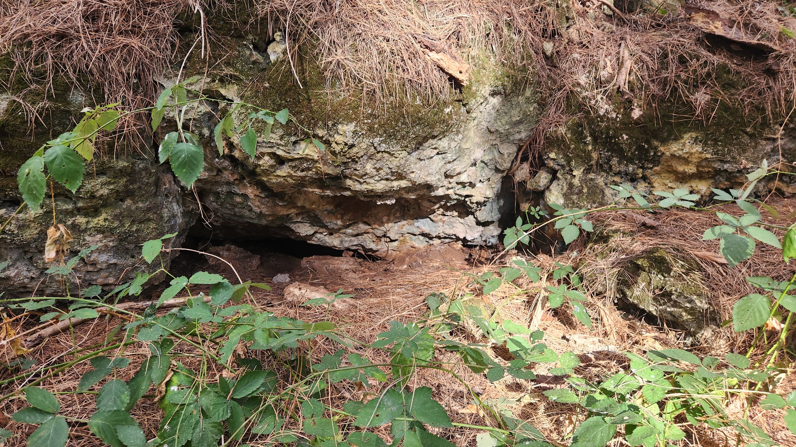

# About

large depression wirh 45 deg bank to one side that has rocky outcrops.  one possible lead but would require work.

# Details

## Identification

- **Feature type:** Depression

## Cave and exploration data

- **Exploration potential:** Low

# References

## Images
- 
- 
