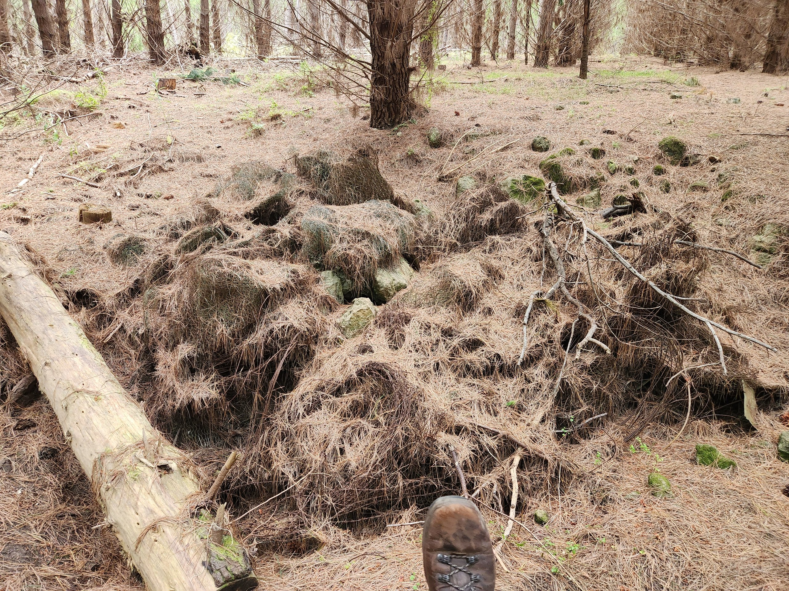

# About

Wire and rock fill hole with a rock vertical rock face .

BC 4/11/2023: Has some potential but needs a lot of clearing and is very high above the water table

# Details

## Identification

- **Feature type:** Depression

## Cave and exploration data

- **Exploration potential:** Low

# References

## Images
- 
- 
- 
