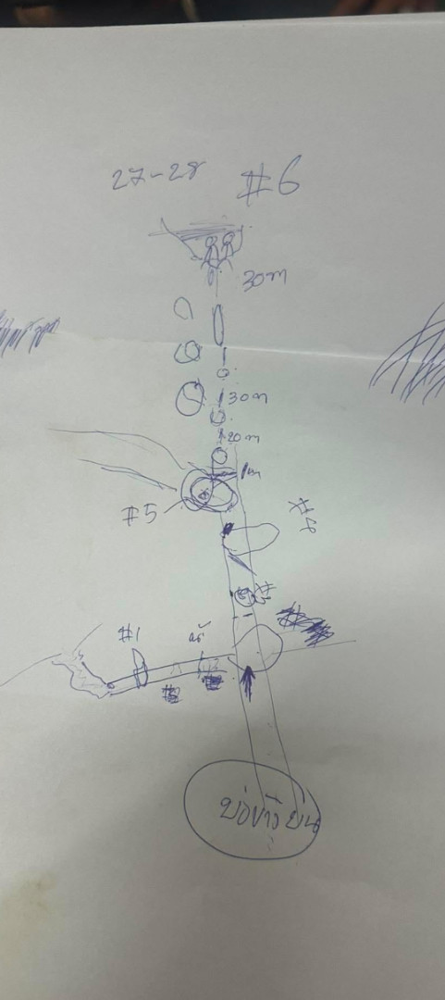
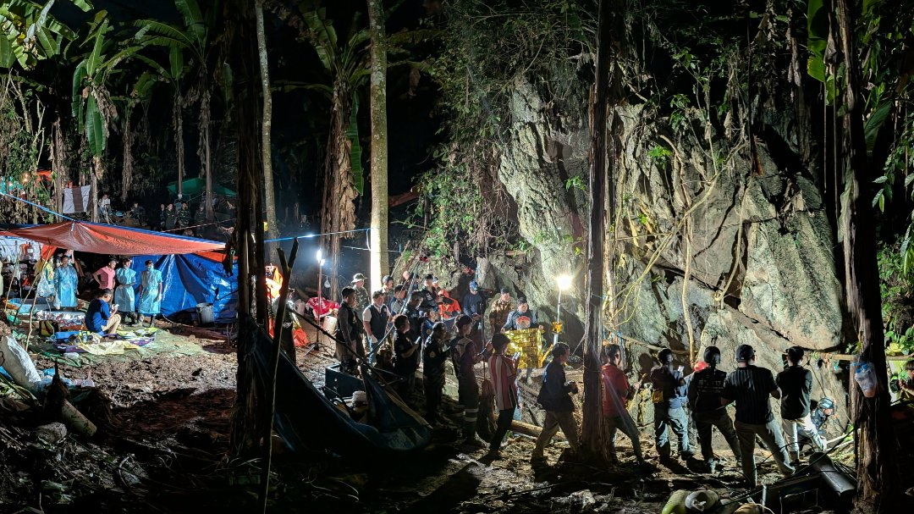
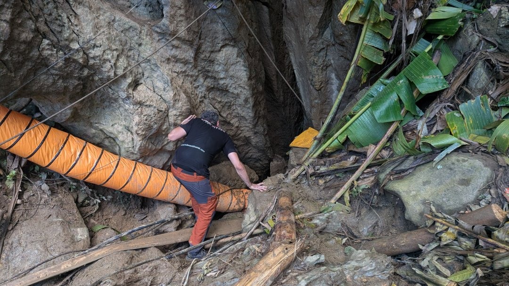

# About

Zero stars - do not recommend

# Details

## Identification

- **Feature type:** Cave

## Cave and exploration data

- **Cave rating:** Advanced
- **Highest cave rating:** Advanced
- **Vertical access:** No
- **Goes to water:** Yes
- **Surveyed length:** 350 m

## Diving data

- **Maximum depth:** 2 m
- **Water type:** Fresh
- **Tidal:** No
- **Temperature:** 22–22 °C
- **Difficulty:** VeryHard
- **Entry difficulty:** VeryHard

## Amenities

- **hasShowers:** No
- **hasToilets:** No
- **hasPhone:** No

# Maps

- 

# References

## Images
- 
- 
- 
