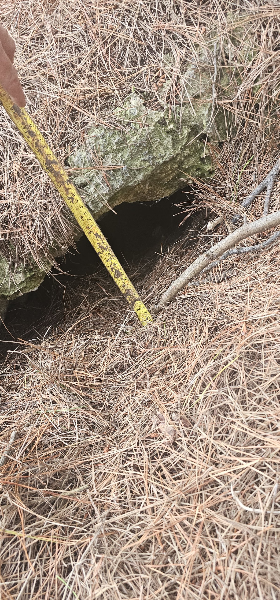
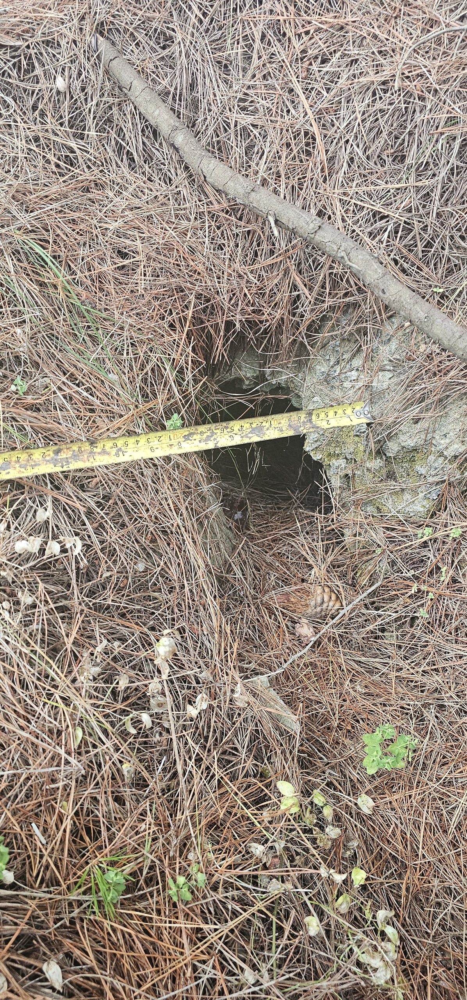
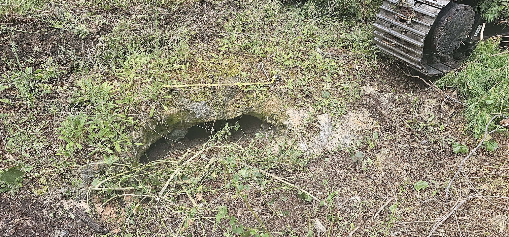
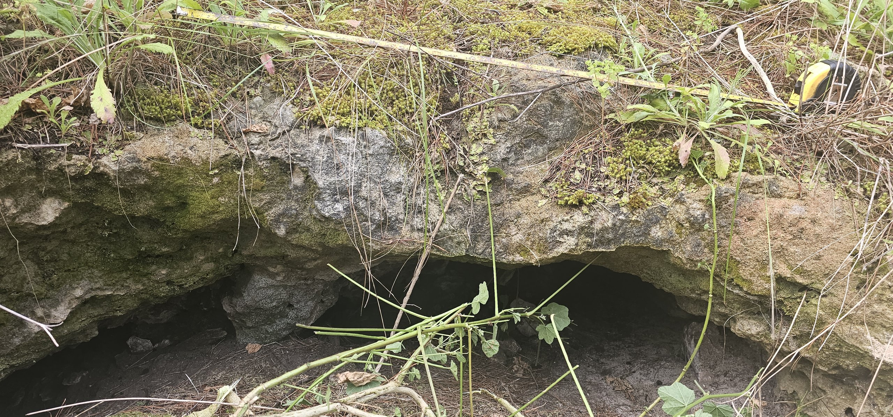
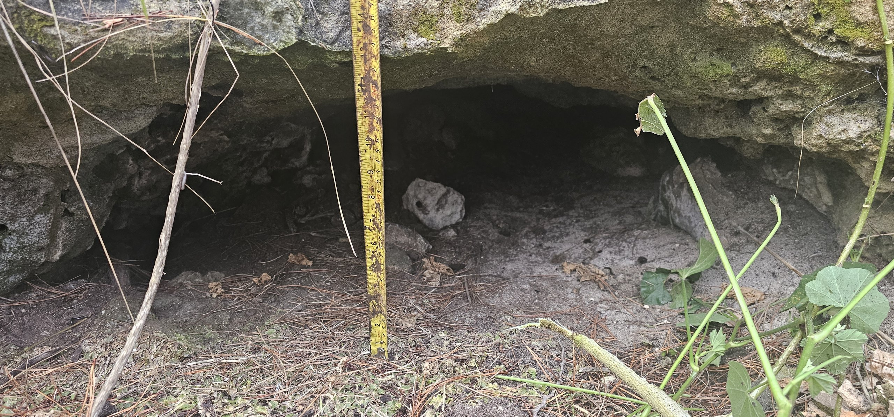

# About

25/11/24 Unmarked cave feature on timberlands forestry site very low and choked up with dirt possibly an animal living in the cave theres also 2 small holes sw of the main hole that look like they may connect up 
Tape measure is set too 1mt

# References

## Images
- 
- 
- 
- 
- 
