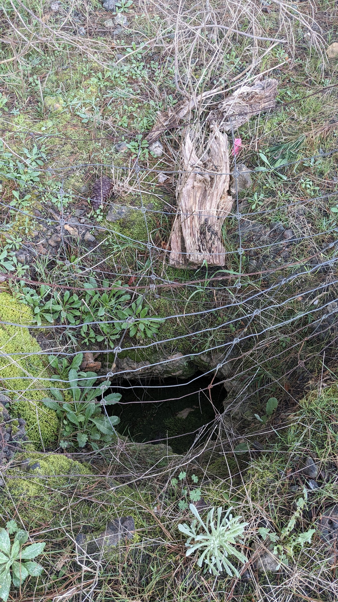
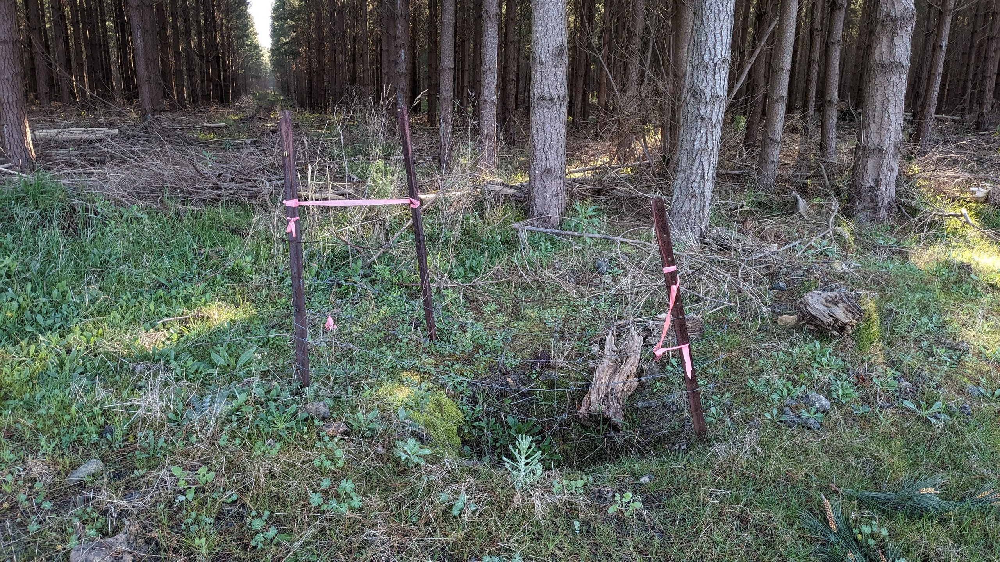

# About

2021-Aug: MW visited on foot and photographed. Small entrance on tree line with wire fence and star pickets around it. Potential lead but will require entrance to be opened further to access.

# Details

## Identification

- **Feature type:** RockyOutcrop
- **Source:** Forestry

## Cave and exploration data

- **Vertical access:** No
- **Exploration potential:** Low

# References

- **Forestry:** Forestry Info: Thin Roof: ?, Fence: ?. Dimensions: ?. Features: ?

## Images
- 
- 
