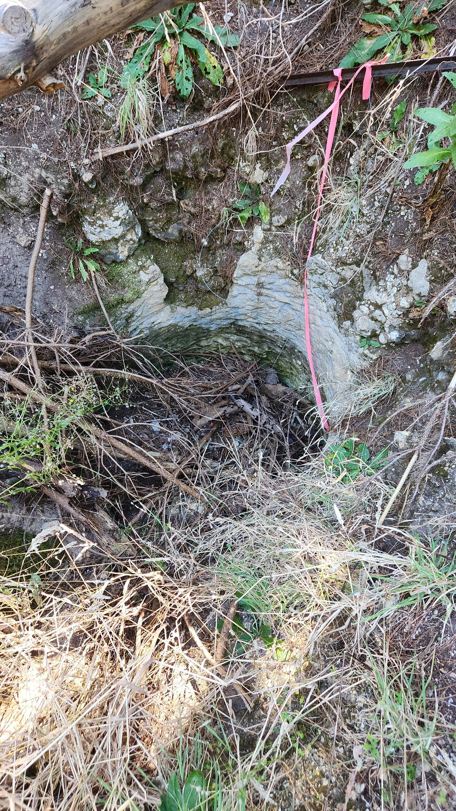
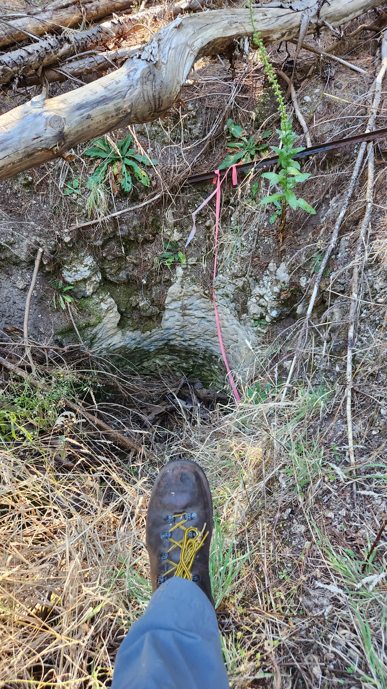

# About

2021-Aug: MW visited on foot and photographed. Small solution tube 1m deep with single wire fence around, eastern side of feature collapsed and tube full of pine needles.

# Details

## Identification

- **Feature type:** SolutionTube
- **Source:** Forestry

## Cave and exploration data

- **Vertical access:** No
- **Goes to water:** No

## Amenities

- **hasShowers:** No
- **hasToilets:** No

# References

- **Forestry:** Thin Roof: ?, Fence: ?. Dimensions: ?. Features: ?

## Images
- 
- 
