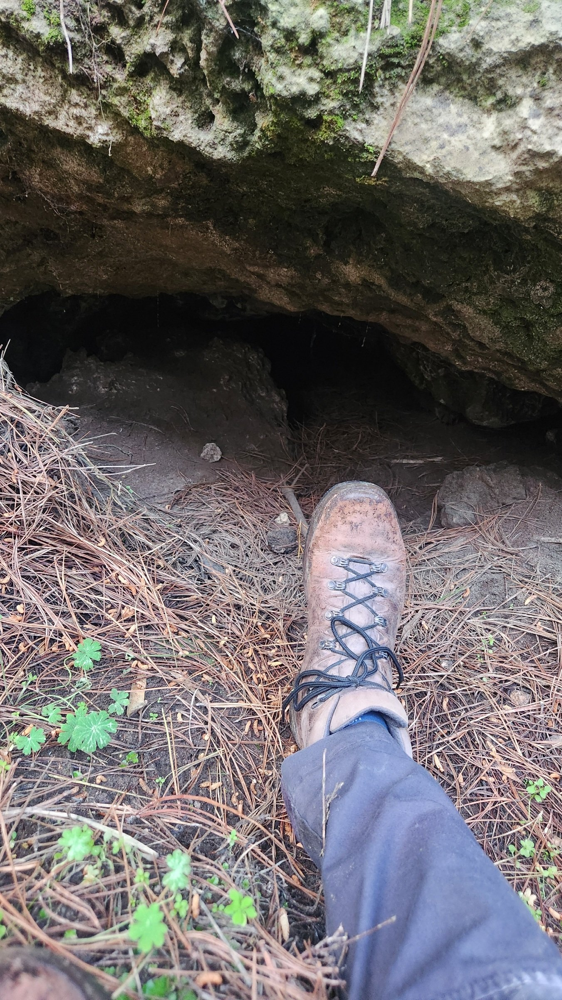
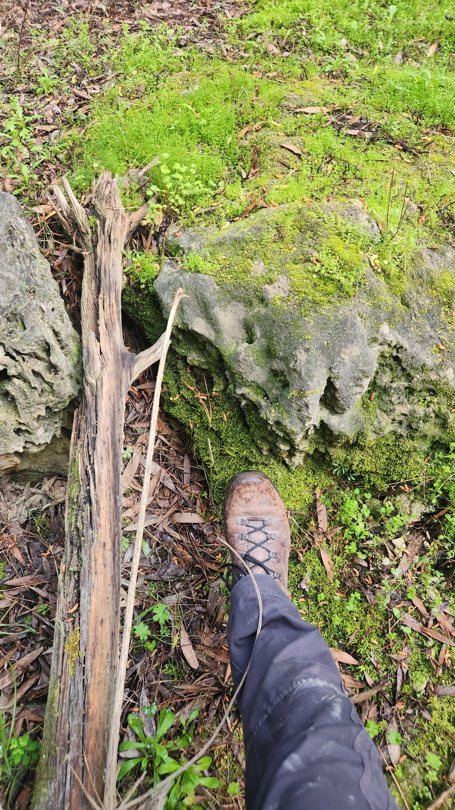
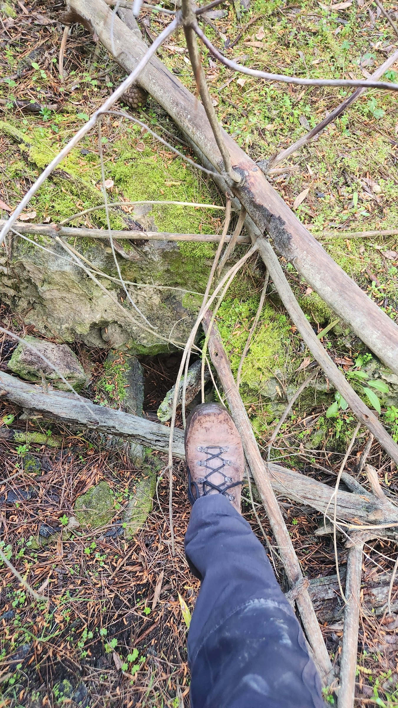
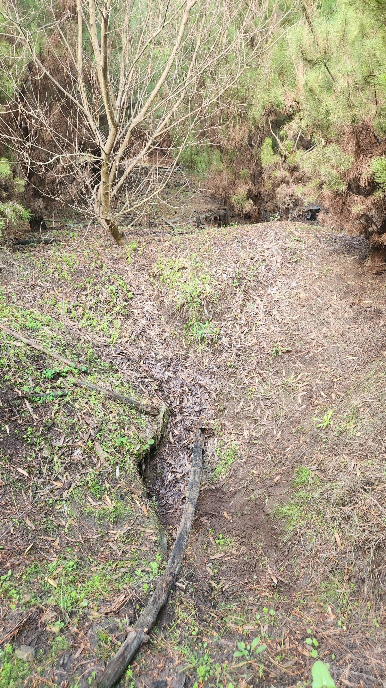
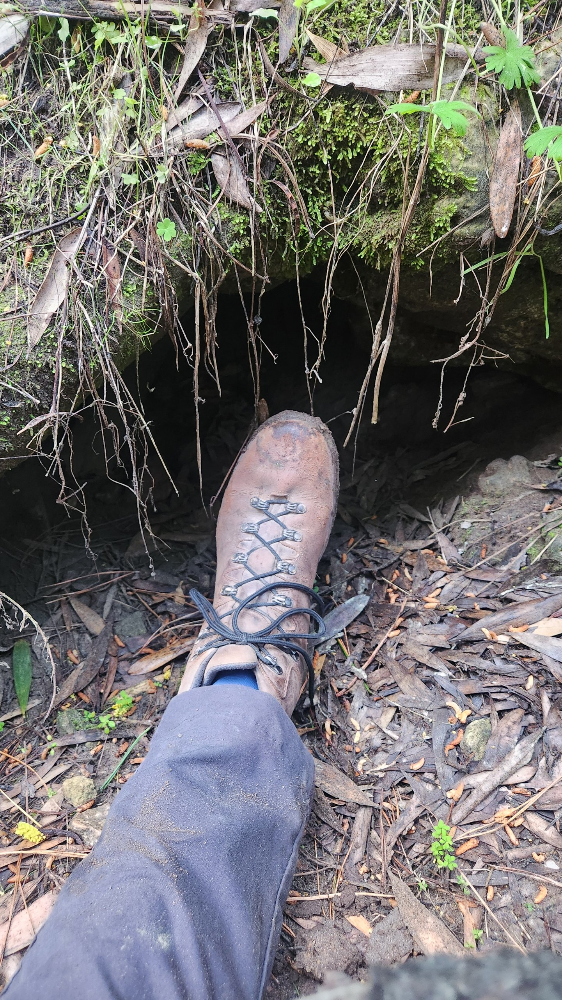

# About

Group of caves?!?!?!

# Details

## Identification

- **Feature type:** Cave
- **Source:** Forestry

## Cave and exploration data

- **Exploration potential:** Medium

# References

- **Forestry:** Thin Roof: ?, Fence: ?. Dimensions: ?. Features: Group of Caves

## Images
- 
- 
- 
- 
- 
- 
- 
