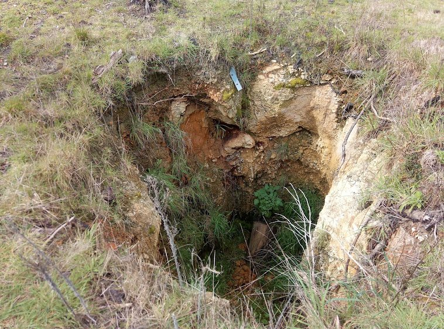
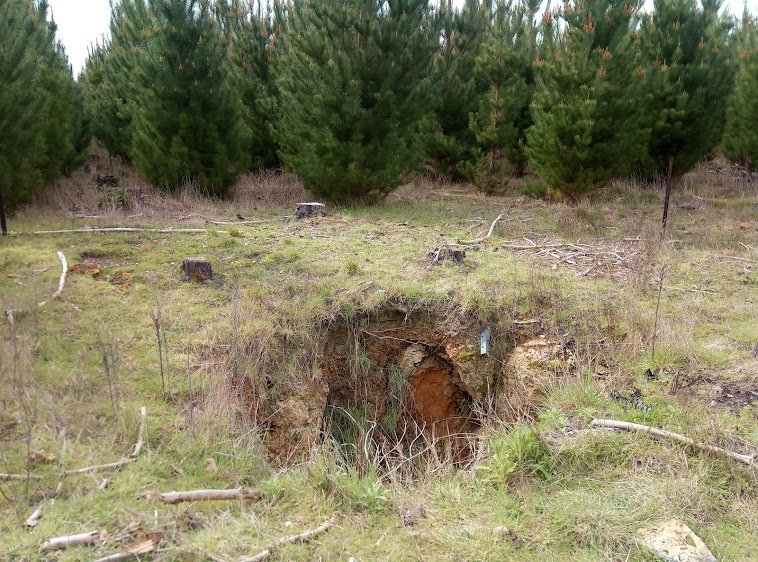

# About

2021-Aug: MW visited on foot & photographed. Solution tube type feature approx 3x4m wide and 3m deep in the middle of a clearing. No obvious leads.

# Details

## Identification

- **Feature type:** SolutionTube
- **Source:** Forestry

## Cave and exploration data

- **Vertical access:** No
- **Goes to water:** No

# References

- **Forestry:** Thin Roof: ?, Fence: ?. Dimensions: ?. Features: ?

## Images
- 
- 
