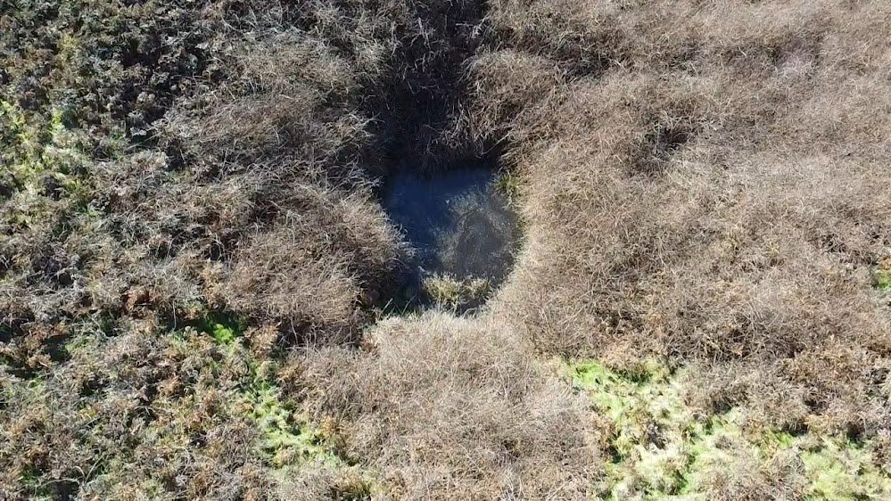
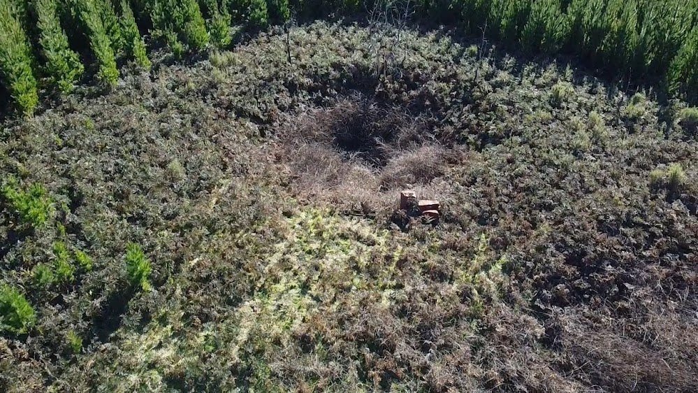
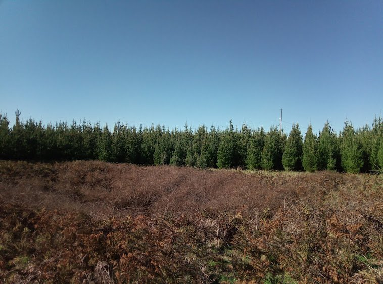
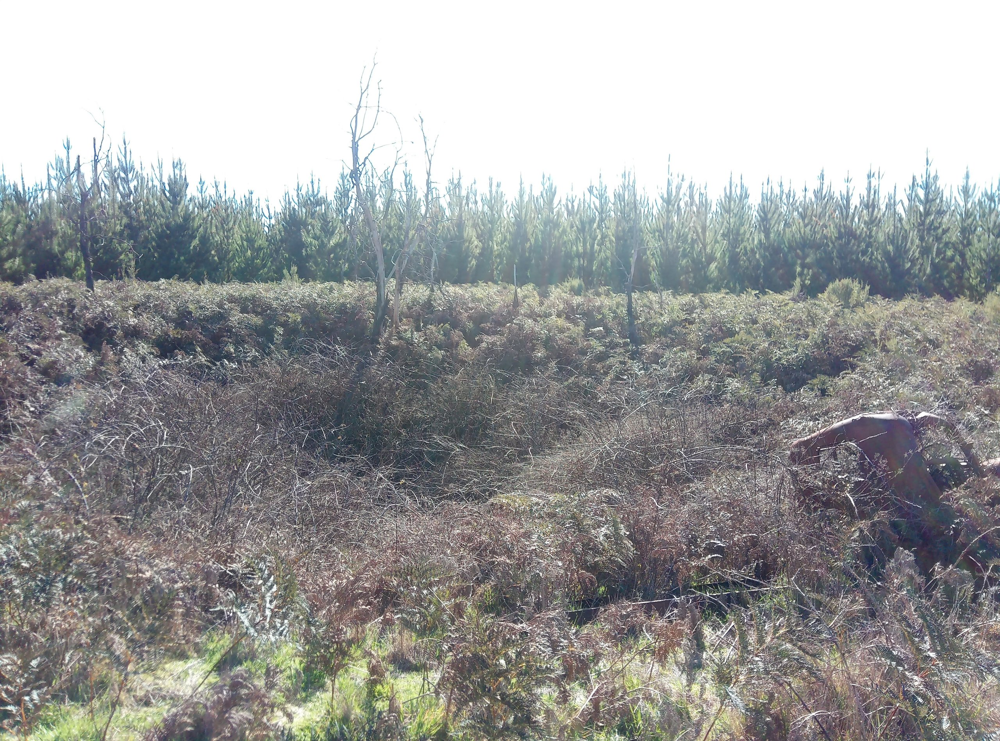

# About

2021-Aug: MW took photographs with drone and on foot. Twin sinkhole saddleback-type feature similar to The Sisters (L43/44). Old rusted truck near Western sinkhole, Extensive prickly blackberry bushes over entiree area - drone shows water at centre of each sinkhole, but unlikely to have potential.

# Details

## Identification

- **Feature type:** Depression
- **Source:** Forestry

## Cave and exploration data

- **Goes to water:** Yes

# References

- **Forestry:** Thin Roof: ?, Fence: ?. Dimensions: ?. Features: ?

## Images
- 
- 
- 
- 
