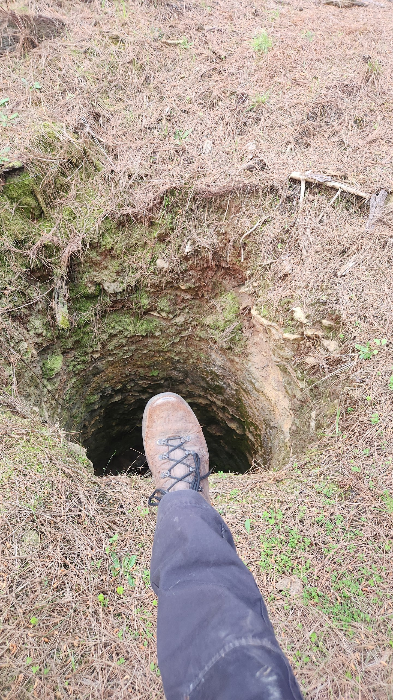
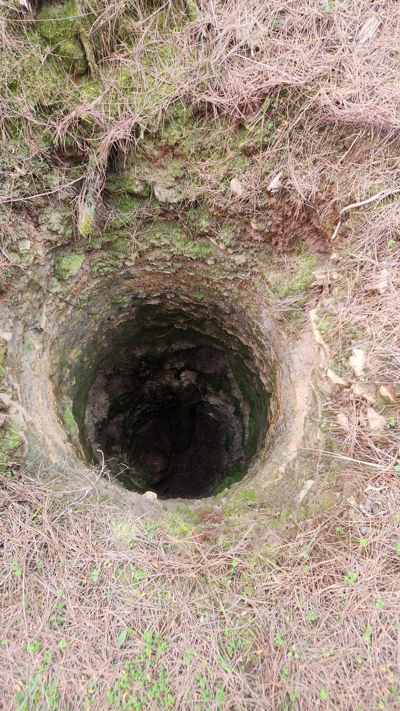

# Details

## Identification

- **Feature type:** Sinkhole
- **Source:** Forestry

## Cave and exploration data

- **Exploration potential:** Low

# References

- **Forestry:** Thin Roof: ?, Fence: ?. Dimensions: ?. Features: Sinkhole

## Images
- 
- 
