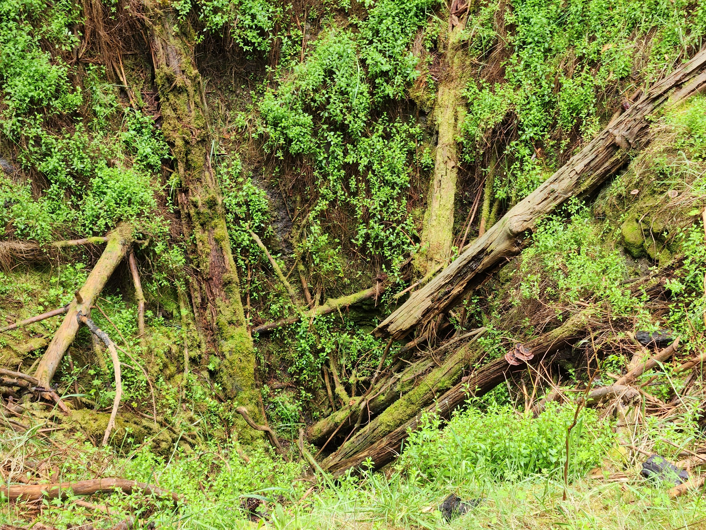
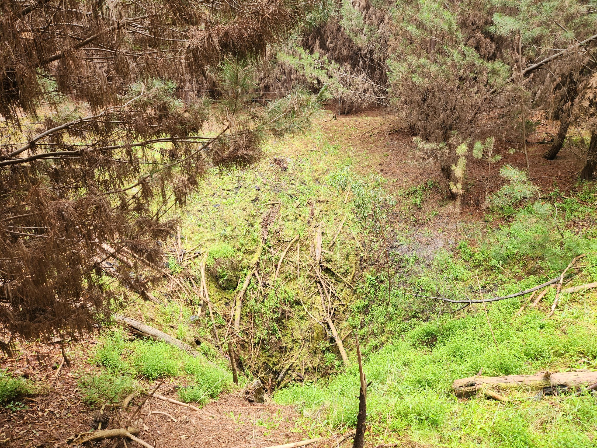

# About

BC 13/10/2023: Steep sided funnel sinkhole 8-10m deep full of branches and forest debris. Would need ladder or ropes to safely approach.  Top is about 10m across and appears around 2m at the choke point

# Details

## Identification

- **Feature type:** Sinkhole
- **Source:** Forestry

## Cave and exploration data

- **Vertical access:** Yes
- **Exploration potential:** Medium

# References

- **Forestry:** Thin Roof: ?, Fence: ?. Dimensions: ?. Features: Sinkhole

## Images
- 
- 
