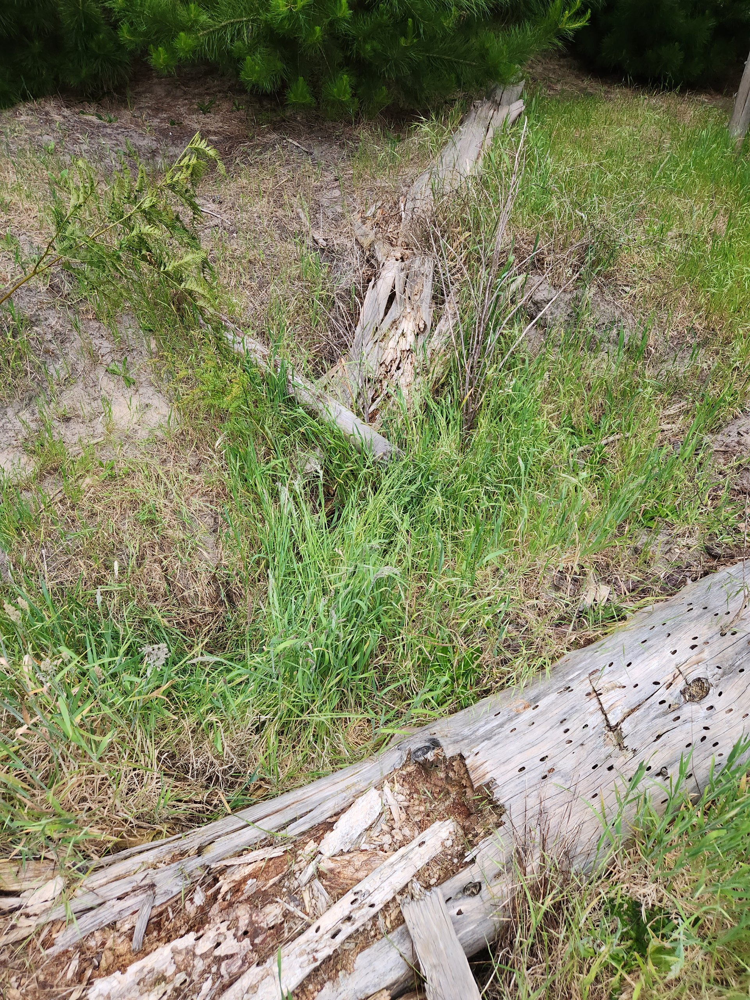
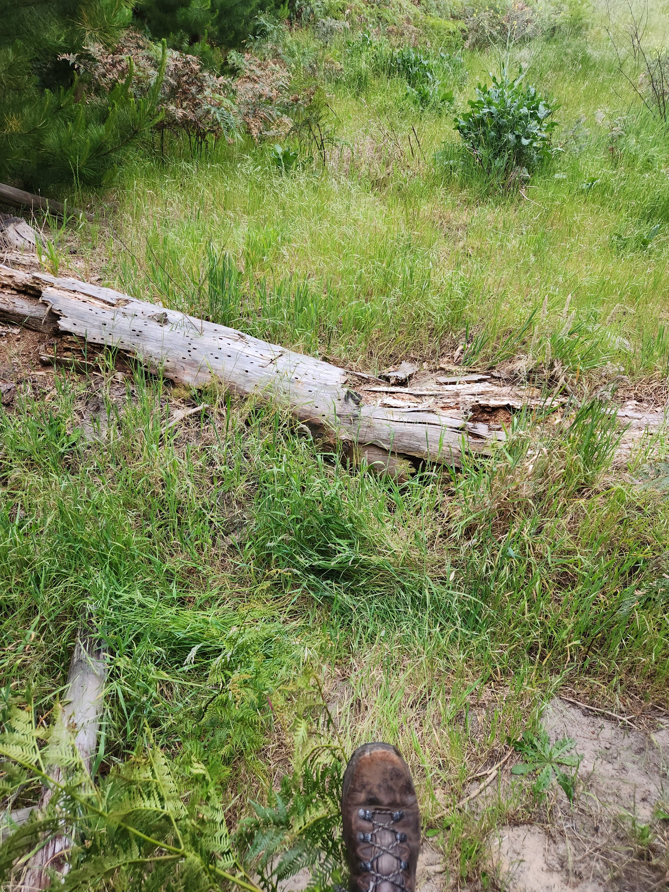

# About

BC 4/11/2023: 1m deep depression.  No sign of karst or entrance

# Details

## Identification

- **Feature type:** Depression
- **Source:** Forestry

## Cave and exploration data

- **Vertical access:** No
- **Exploration potential:** Low

# References

- **Forestry:** Thin Roof: ?, Fence: ?. Dimensions: ?. Features: ?

## Images
- 
- 
