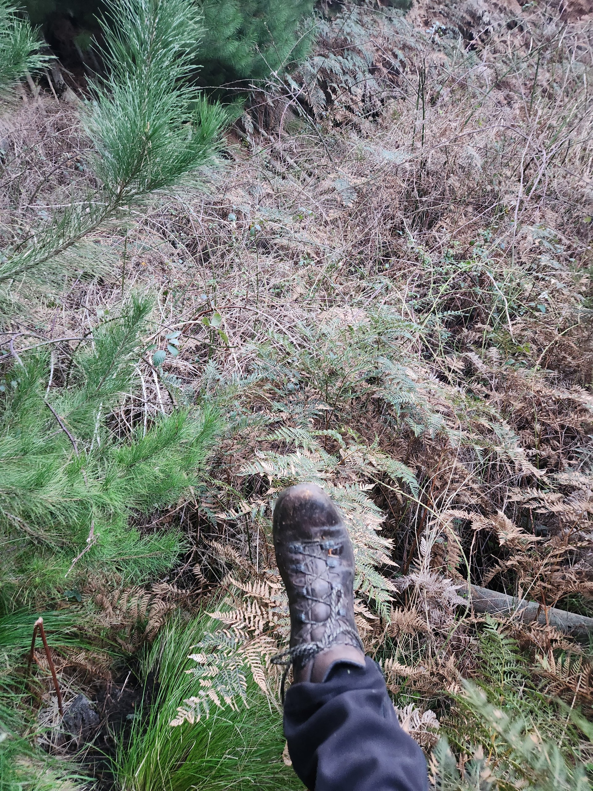
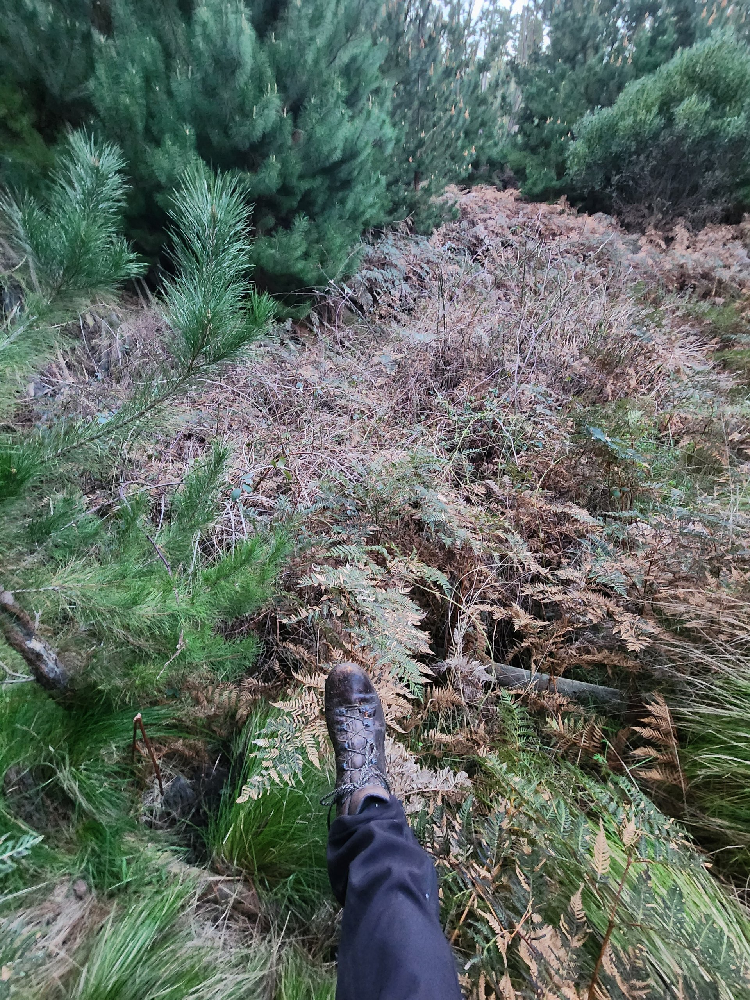

# About

2021-Aug: MW flew over with drone. Small clearing in forest - no obvious karst, but marked by Forestry so worth inspection on foot.

2021-Aug2: MW flew over with drone & photographed.Low scrub with heavy/dead growth near centre - possible karst feature covered by growth.

BC 5/8/2023: Visited on foot. Deep brush that would require significant clearing to see if there was any potential

# Details

## Identification

- **Feature type:** Sinkhole
- **Source:** Forestry

## Cave and exploration data

- **Vertical access:** No
- **Exploration potential:** Low

# References

- **Forestry:** Thin Roof: ?, Fence: ?. Dimensions: ?. Features: Sinkhole

## Images
- 
- 
