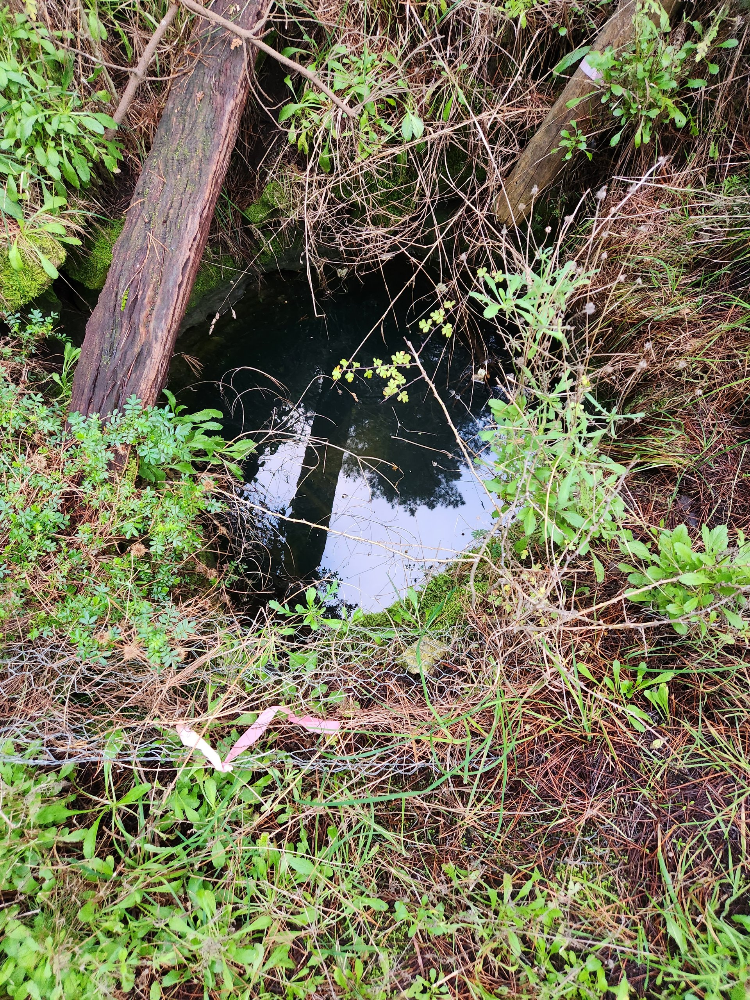
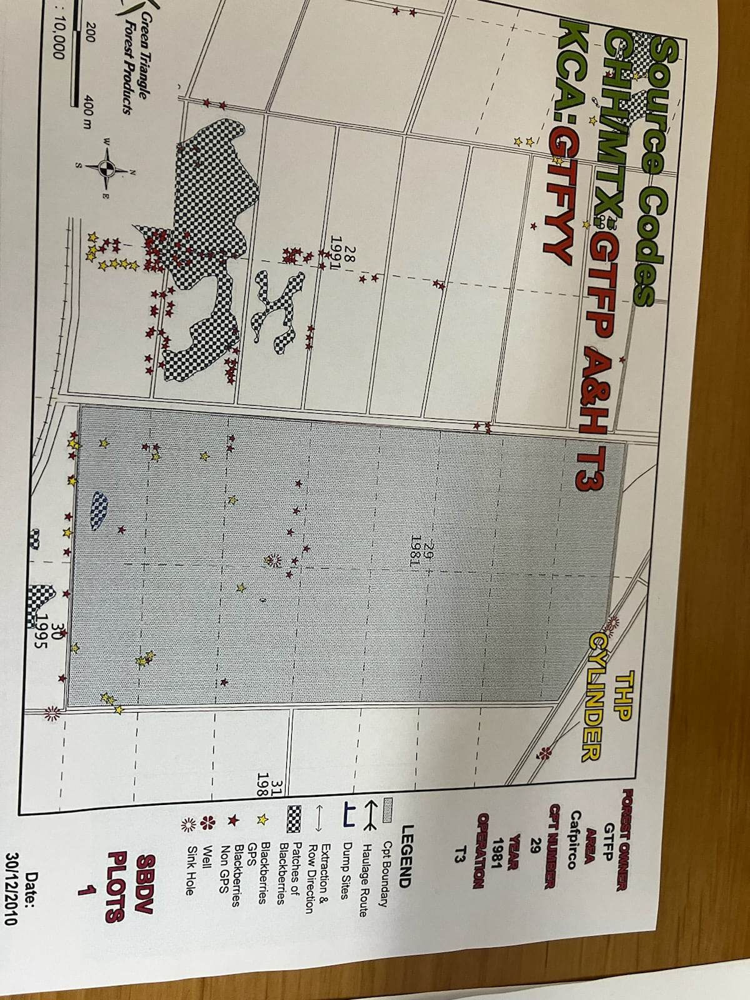
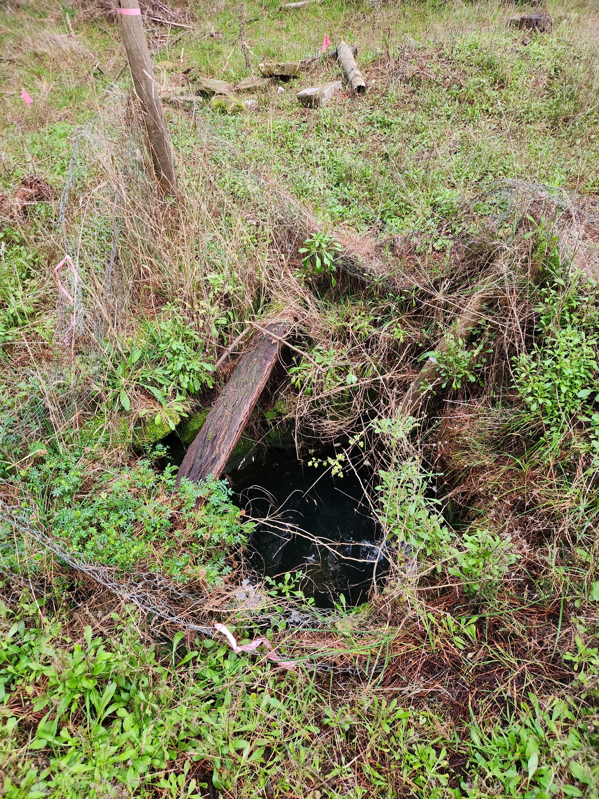
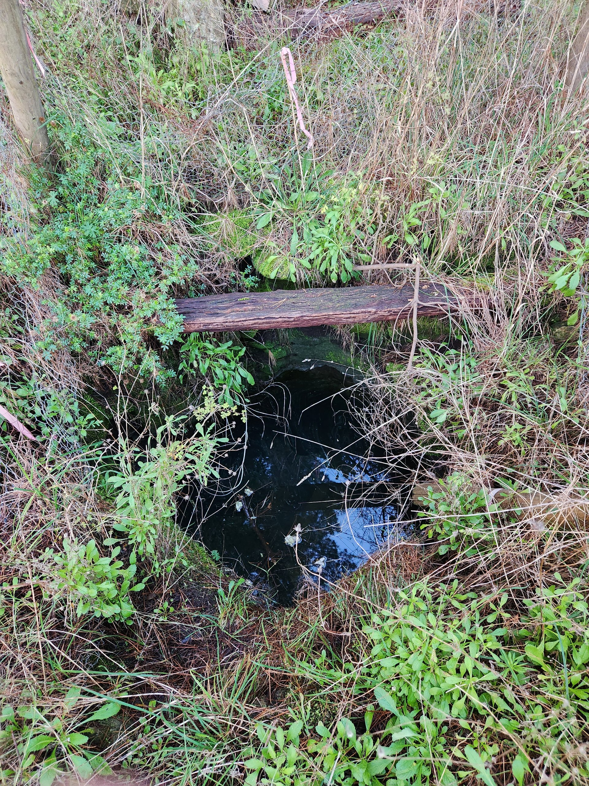
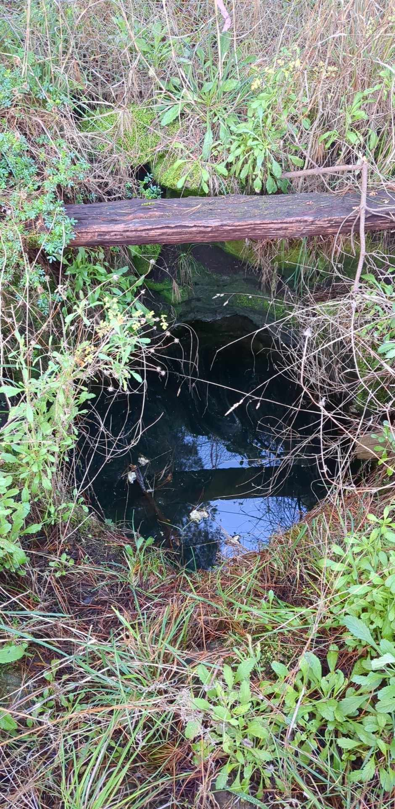

# About

From Col's List
MW / BC : hole with water to top.

# Details

## Identification

- **Feature type:** SolutionTube

## Cave and exploration data

- **Vertical access:** No
- **Exploration potential:** High
- **Tourism potential:** Low
- **Disabled access potential:** Low
- **Goes to water:** Yes

# References

## Images
- 
- 
- 
- 
- 
