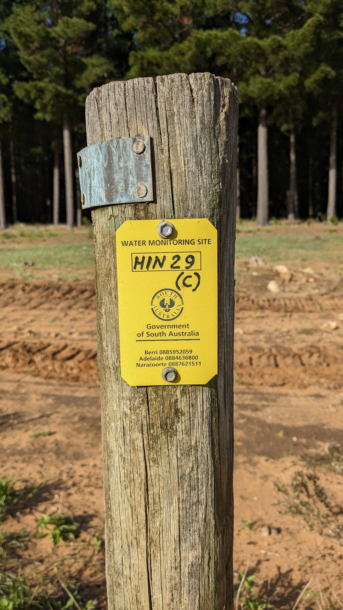
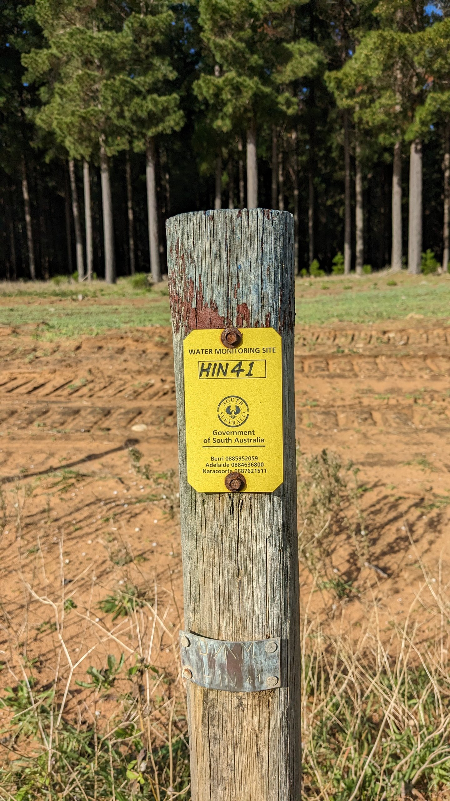
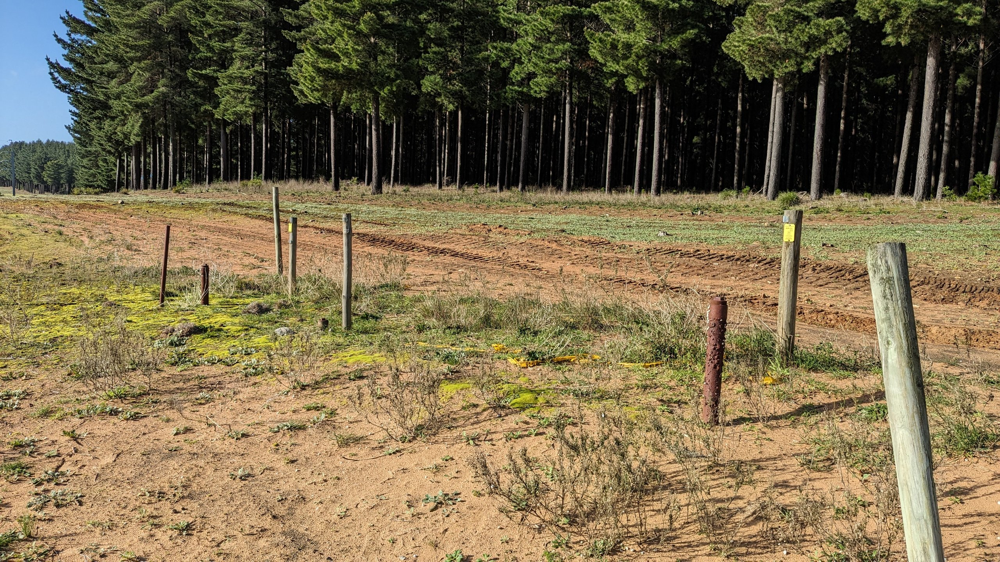

# About

Water monitoring site

# Details

## Identification

- **Feature type:** NotFound

## Cave and exploration data

- **Vertical access:** No
- **Disabled access potential:** Medium

# References

## Images
- 
- 
- 
