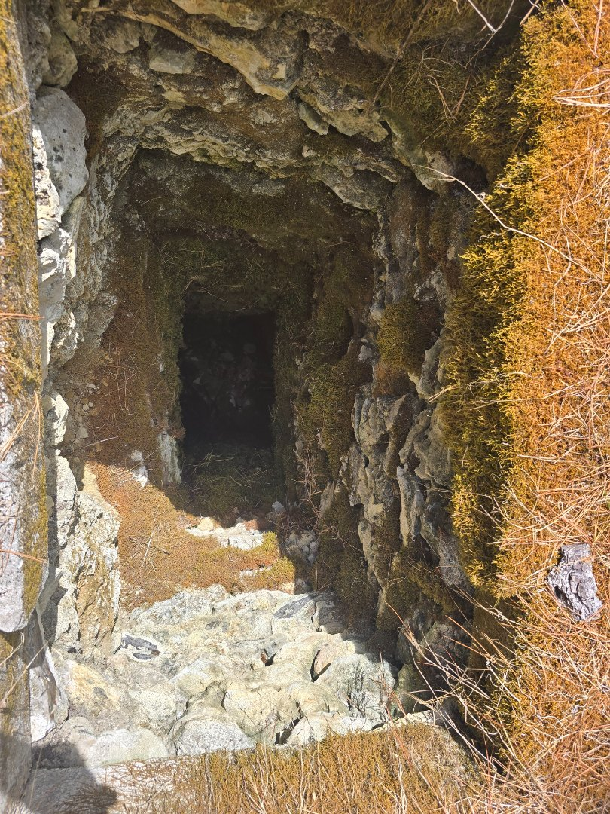
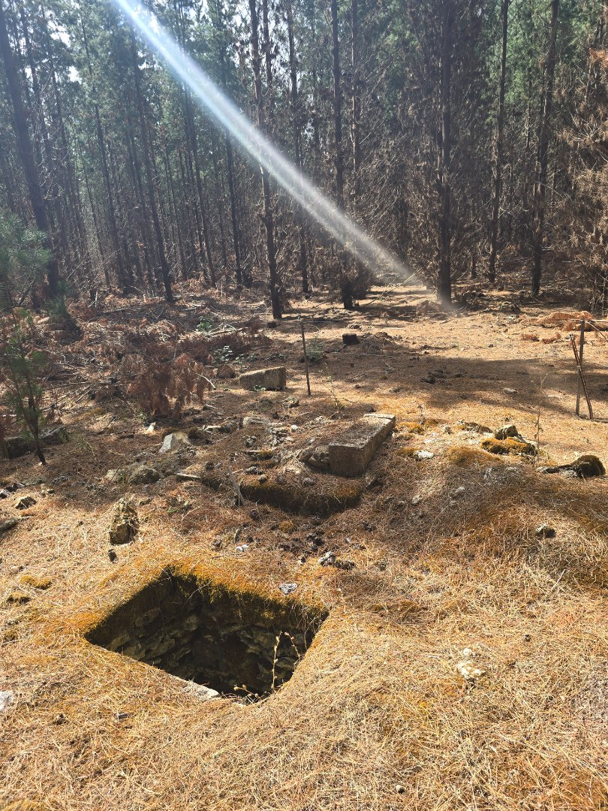

# Details

## Identification

- **Reference:** L1025
- **Source:** Forestry SA

## Access and warnings

Forestry

# References

- **Forestry SA:** L1025, Thin Roof: ?, Fence: N. Dimensions: 1300mm x 600mm x 10m deep. Features: Open limestone lined well with a platform nearby

## Images
- 
- 
