# About

Checked 2024-07 by MW 
6m vertical entrance requiring wire ladder

# Details

## Identification

- **Feature type:** Cave

## Cave and exploration data

- **Vertical access:** Yes

## Amenities

- **hasShowers:** No
- **hasToilets:** No

# References

## Images
- 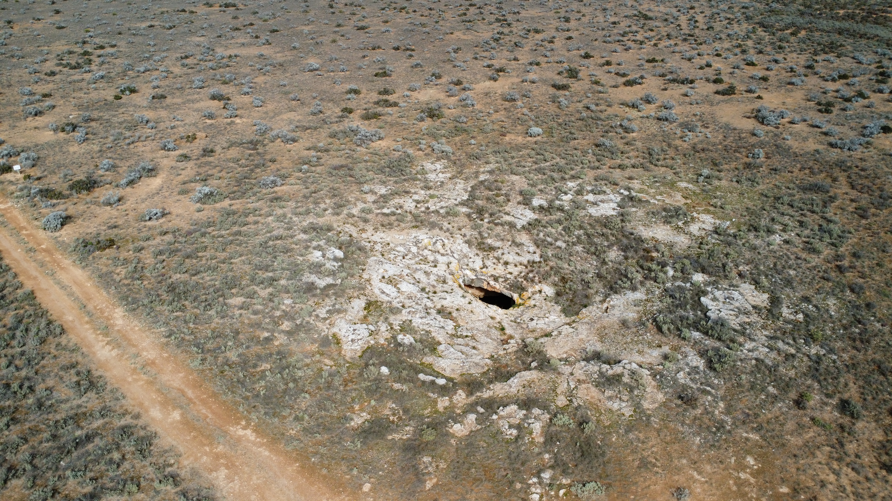
- 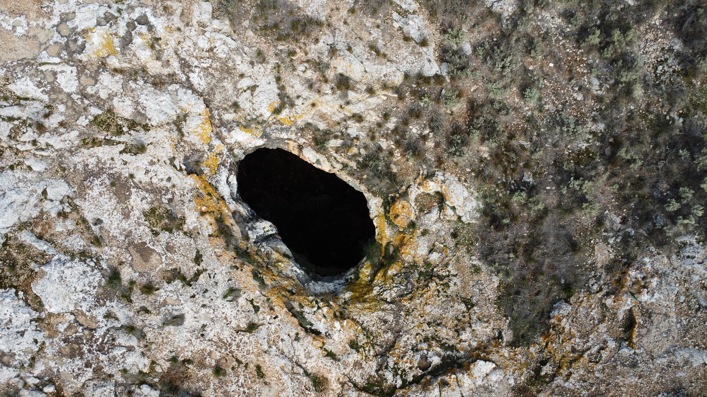
- 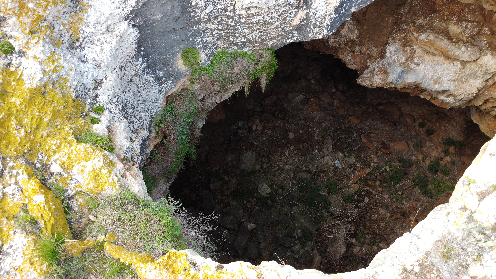
- 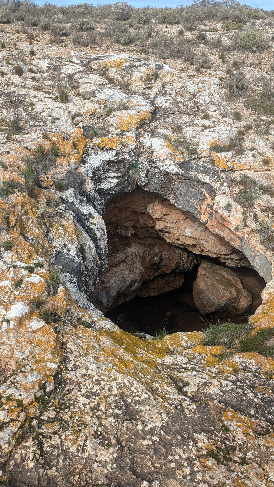
- 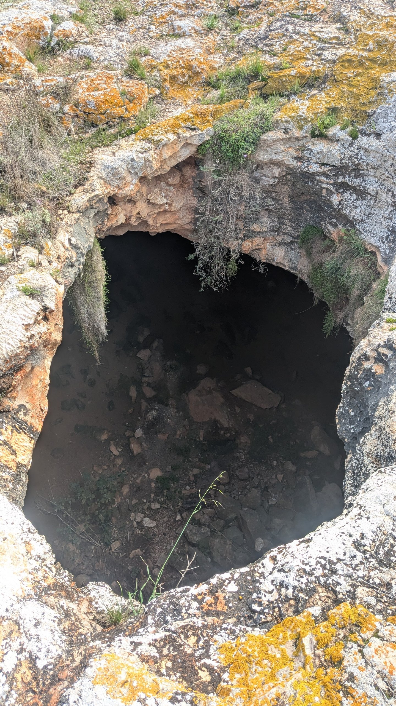
- 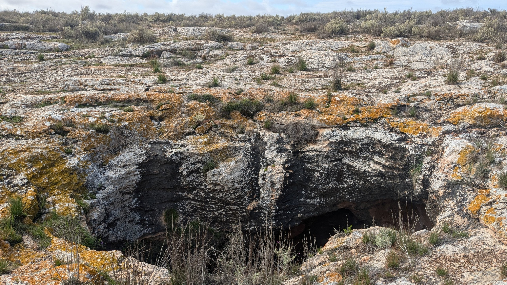
- 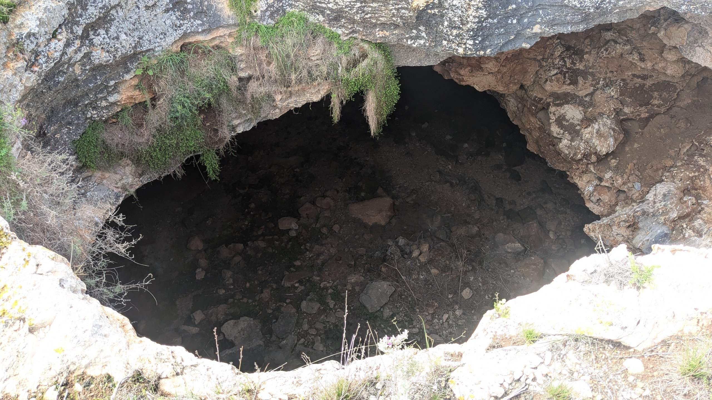
- 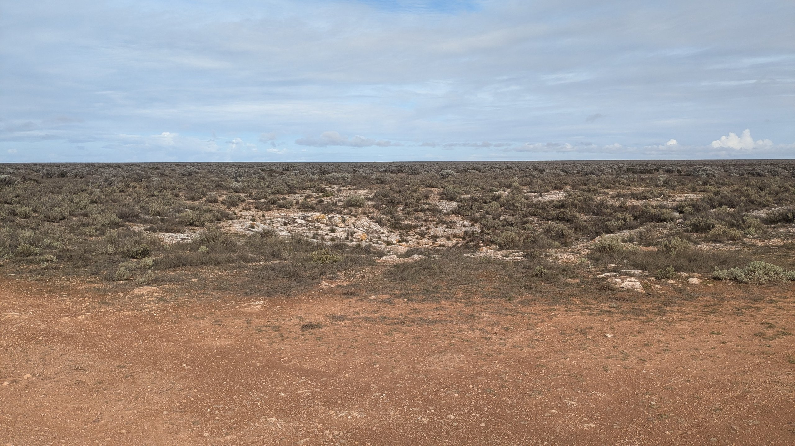
- 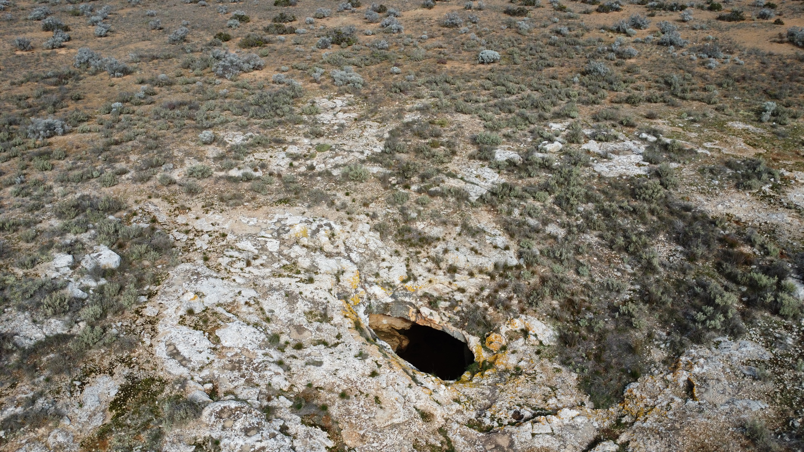

## ASF slide images

Images are from the ASF Joe N. Jennings slide catalogue. Each caption preserves the catalogue description and links to its source record.

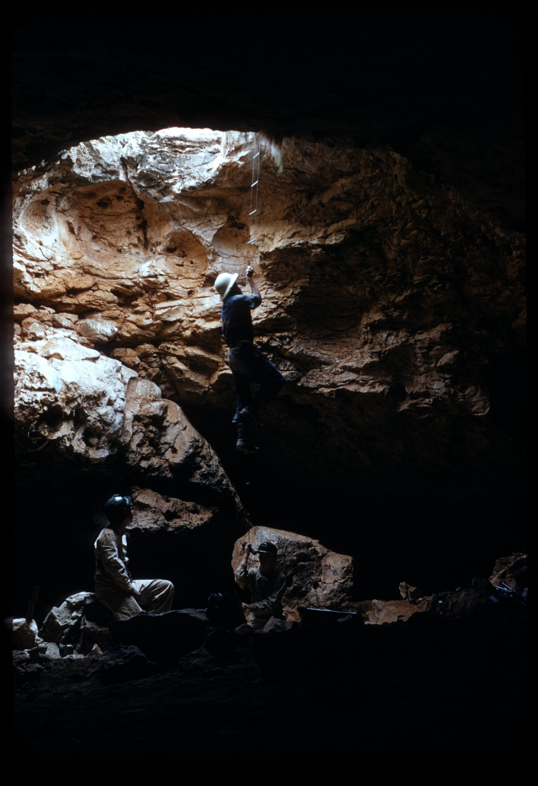
*ASF Joe N. Jennings slide catalogue, JNJ-S-1007-11, Box 1007. Catalogue description: White Wells Cave. [ASF record](https://st1.asflib.net/MEDIA/ASFJJSlidesCatalogue/Box%201007/JNJ-S-1007-11.html).*

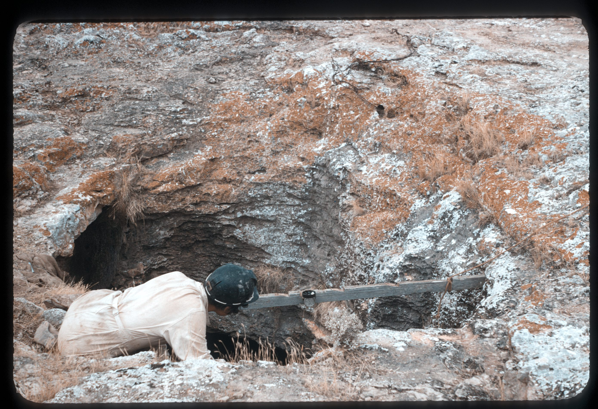
*ASF Joe N. Jennings slide catalogue, JNJ-S-1007-12, Box 1007. Catalogue description: White Wells Cave - Measuring drafts. [ASF record](https://st1.asflib.net/MEDIA/ASFJJSlidesCatalogue/Box%201007/JNJ-S-1007-12.html).*

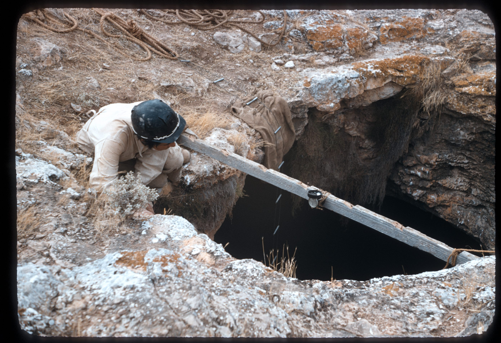
*ASF Joe N. Jennings slide catalogue, JNJ-S-1007-13, Box 1007. Catalogue description: White Wells Cave - Measuring wind. [ASF record](https://st1.asflib.net/MEDIA/ASFJJSlidesCatalogue/Box%201007/JNJ-S-1007-13.html).*

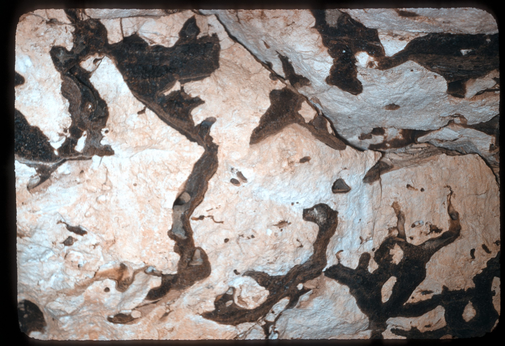
*ASF Joe N. Jennings slide catalogue, JNJ-S-1007-14, Box 1007. Catalogue description: White Wells Cave - Calcite filled solution tubes. [ASF record](https://st1.asflib.net/MEDIA/ASFJJSlidesCatalogue/Box%201007/JNJ-S-1007-14.html).*

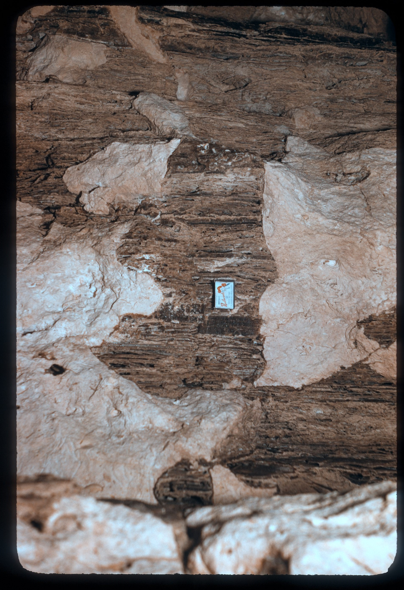
*ASF Joe N. Jennings slide catalogue, JNJ-S-1007-15, Box 1007. Catalogue description: White Wells Cave - ? fill of spongework. [ASF record](https://st1.asflib.net/MEDIA/ASFJJSlidesCatalogue/Box%201007/JNJ-S-1007-15.html).*

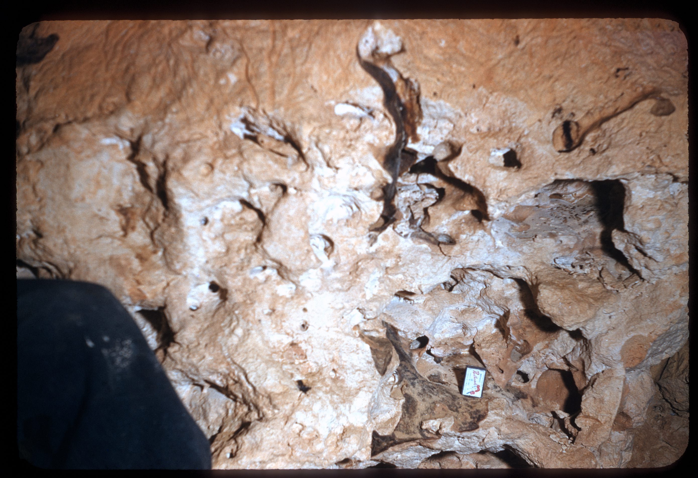
*ASF Joe N. Jennings slide catalogue, JNJ-S-1007-16, Box 1007. Catalogue description: White Wells Cave - Spongework. [ASF record](https://st1.asflib.net/MEDIA/ASFJJSlidesCatalogue/Box%201007/JNJ-S-1007-16.html).*

<!-- ASF slide images: end -->
