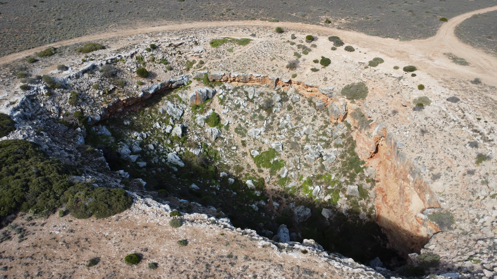
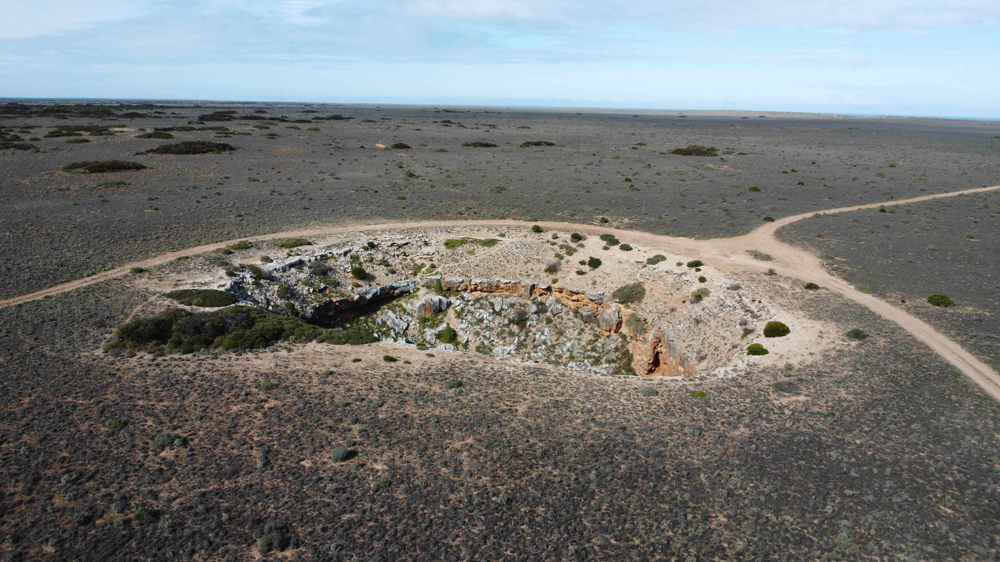
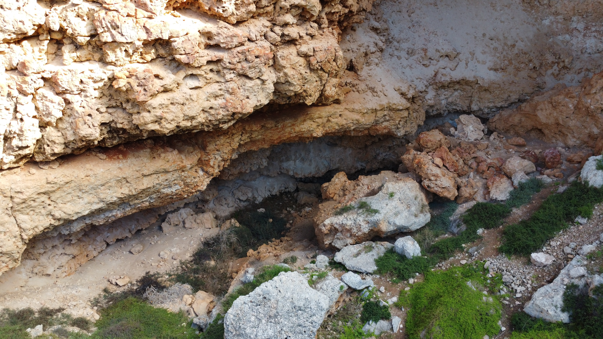
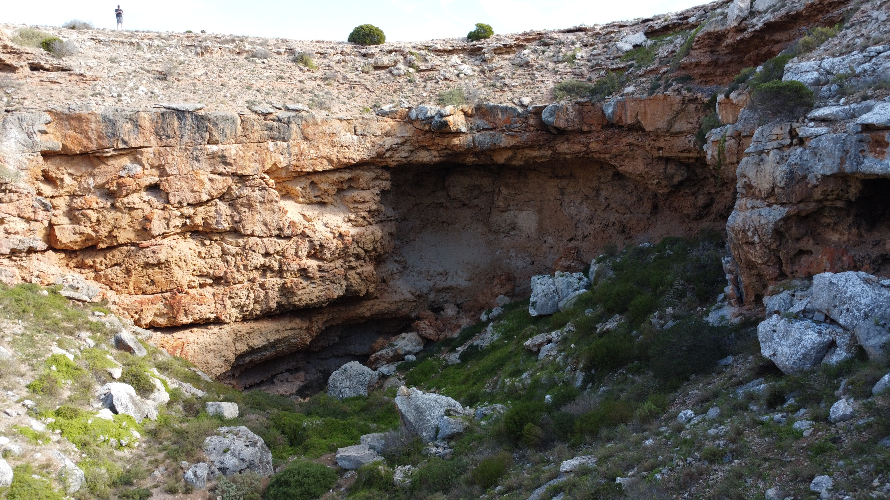
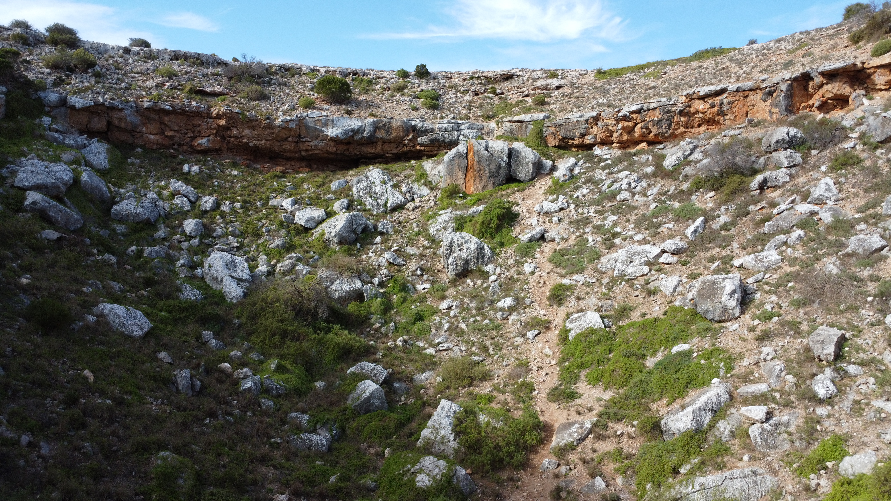
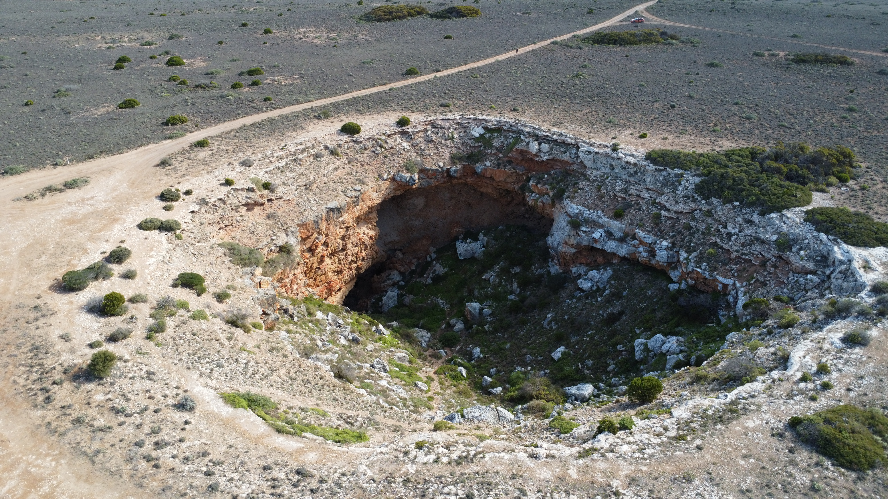

# About

Checked 2024-07 by MW 
Large open doline with potential cave entrance on Western side.

# Details

## Identification

- **Feature type:** Cave

## Cave and exploration data

- **Vertical access:** No
- **Tourism potential:** Medium

## Amenities

- **hasShowers:** No
- **hasToilets:** No

# References

## Images
- 
- 
- 
- 
- 
- 
