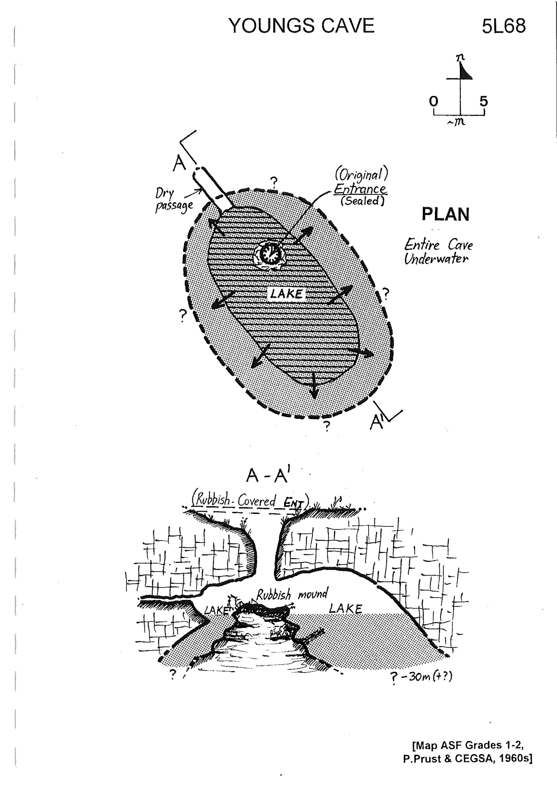
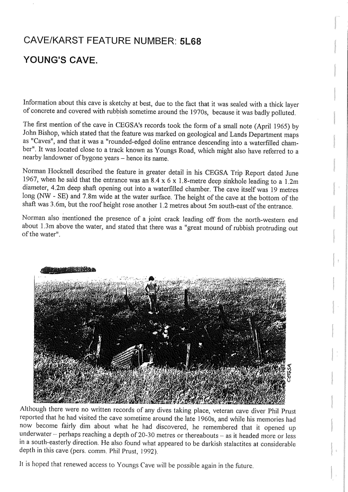

# About

Rough location based on LSECR - look for rubbish pile?

# Details

## Identification

- **Feature type:** Cave
- **Source:** LSECR

## Cave and exploration data

- **Cave rating:** Cave
- **Vertical access:** Yes
- **Exploration potential:** Medium
- **Goes to water:** Yes

## Diving data

- **Water type:** Fresh
- **Tidal:** No
- **Entry type:** Shore

## Amenities

- **hasShowers:** No
- **hasToilets:** No
- **parking:** Outstanding

# References

- **LSECR:** pg 140

## Images
- 
- 
