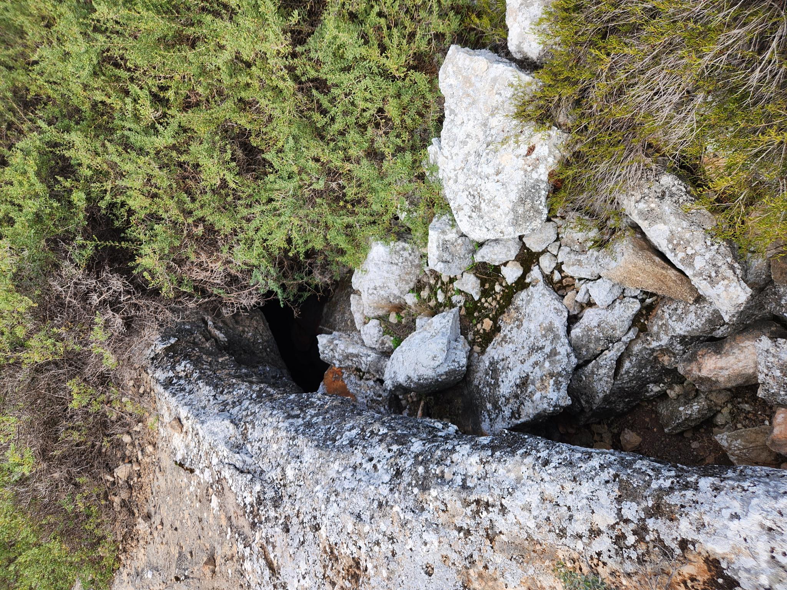
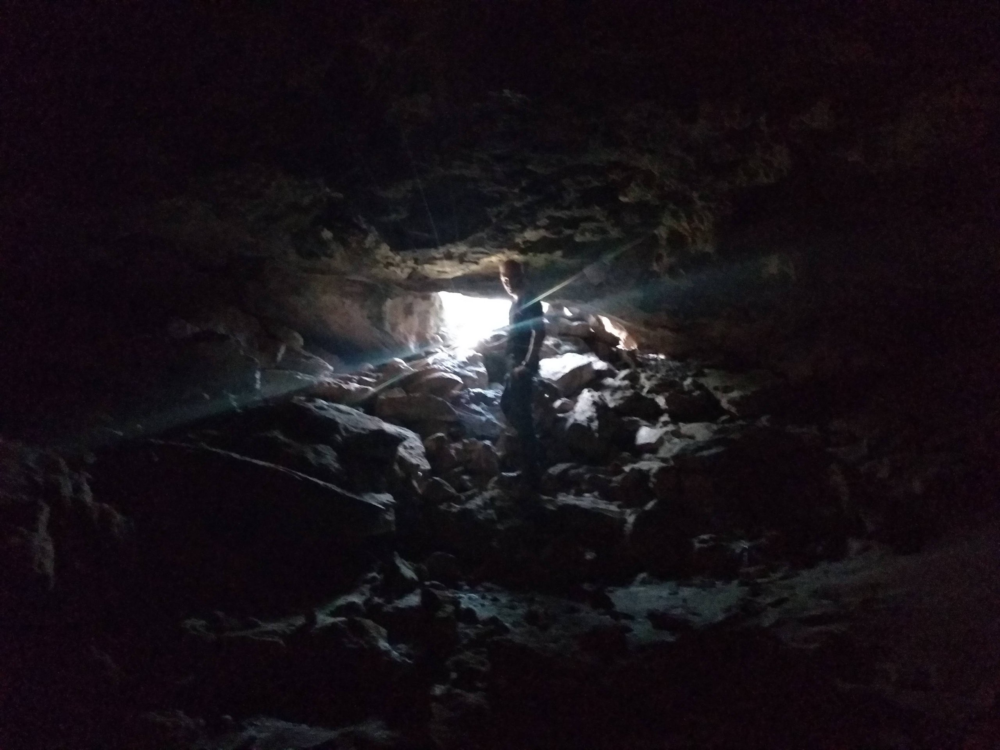
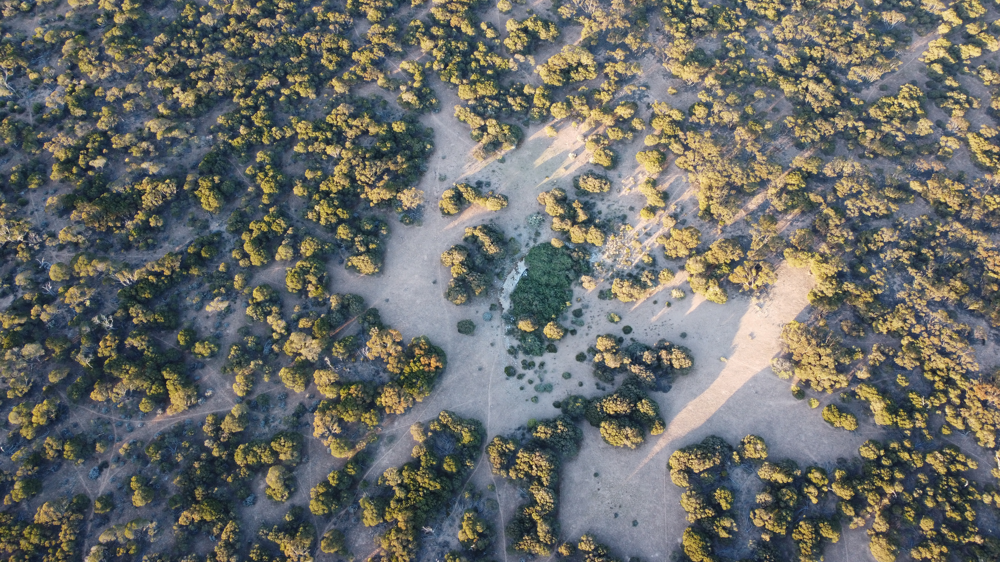
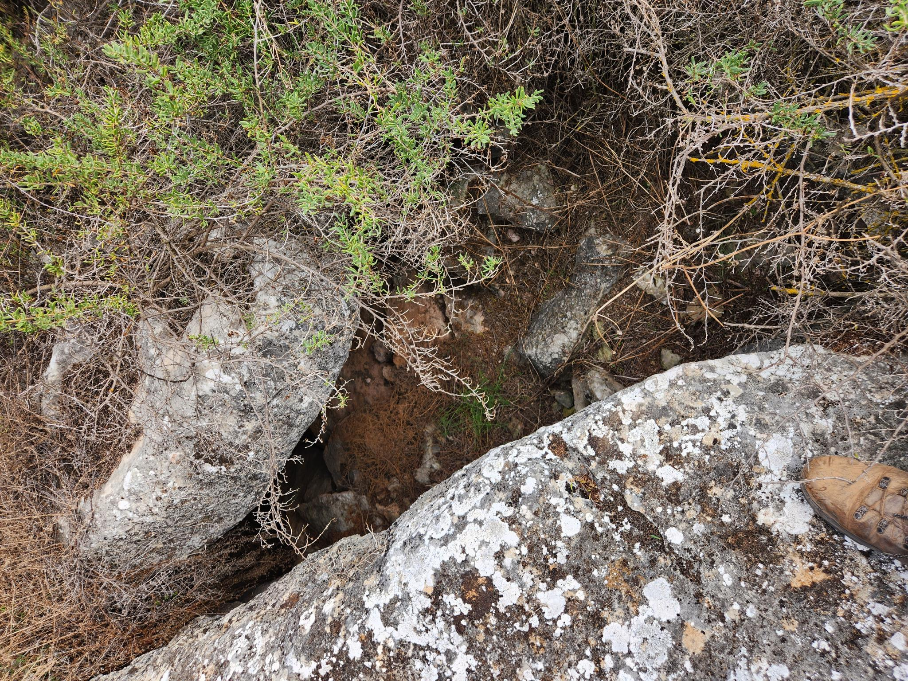
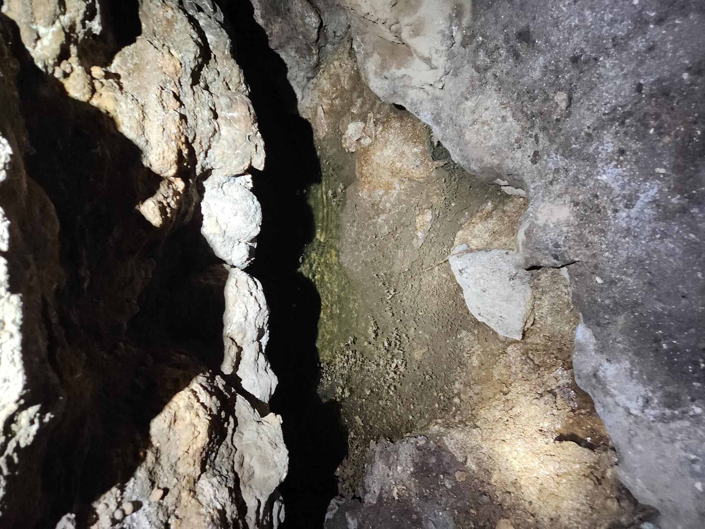
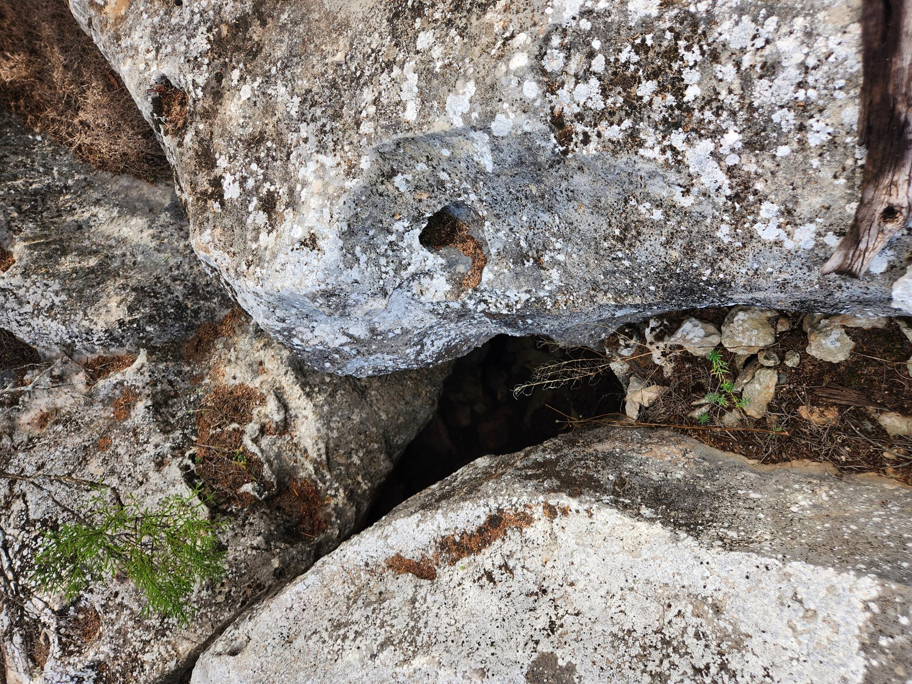

# About

Line into water - connects to Olwolgin?

# Details

## Identification

- **Feature type:** Cave

## Cave and exploration data

- **Cave rating:** Advanced
- **Vertical access:** No
- **Exploration potential:** High
- **Goes to water:** Yes

## Diving data

- **Water type:** Salt
- **Tidal:** No

# References

## Images
- 
- 
- 
- 
- 
- 
