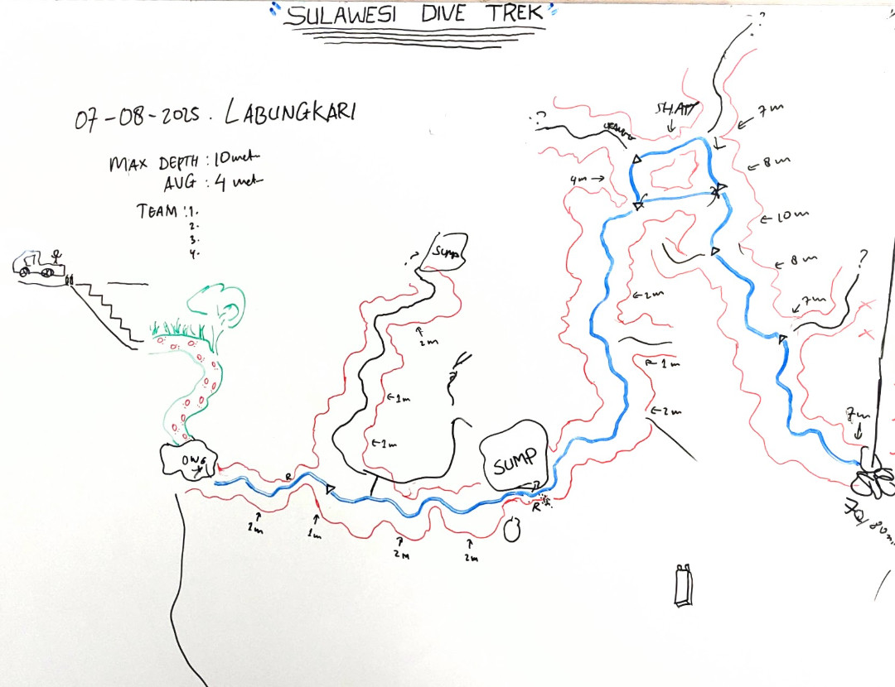

# Details

## Identification

- **Feature type:** Cave
- **System name:** Laulawi

## Cave and exploration data

- **Cave rating:** Cave
- **Highest cave rating:** Advanced
- **Vertical access:** No
- **Exploration potential:** Medium
- **Tourism potential:** Medium
- **Goes to water:** Yes

## Diving data

- **Water type:** Fresh
- **Tidal:** No
- **Temperature:** 25–26 °C
- **Difficulty:** Easy
- **Entry difficulty:** Easy
- **Entry type:** Shore

## Amenities

- **hasShowers:** No
- **hasToilets:** No
- **hasPhone:** Yes
- **family:** Ok
- **parking:** Excellent

# References

## Images
- 
- [1fe0cb6e-33a8-425b-8562-1b803b1a7e66](https://www.youtube.com/watch?v=PsA-guWX61o)
