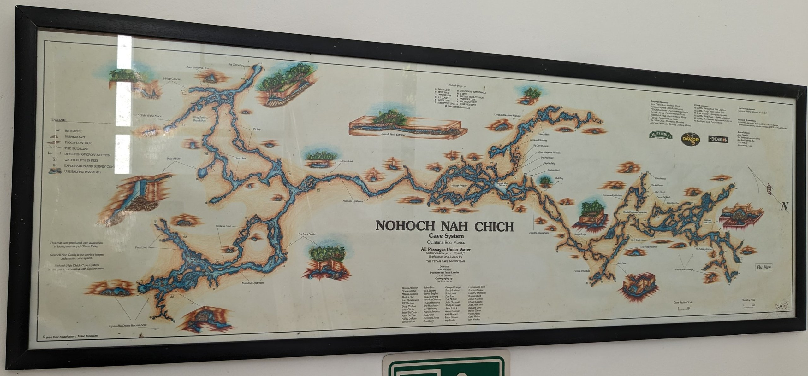
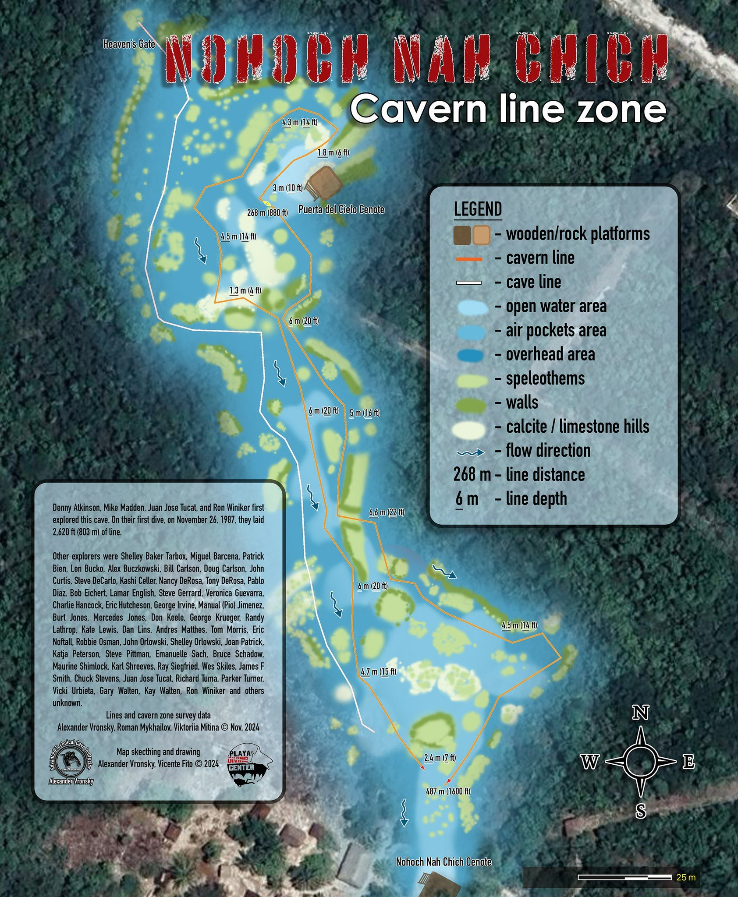

# About

Features Heaven's Gate, Ron's Line Helectites and connection to Pet Semetary

# References

MNemo Data: [NoHoch](https://github.com/twosharprocks/Karst-Database/blob/d6f539534154fcd23f60d0a25899bf7ef553f1d8/Regions/Yucatan/NoHoch.tml)
KML Survey: [Nohoch - KML](https://github.com/twosharprocks/Karst-Database/blob/d6f539534154fcd23f60d0a25899bf7ef553f1d8/Regions/Yucatan/Nohoch.kml)

## Images
- 
- 
- [nohoch - 1c4b036f-5dd24265](https://github.com/twosharprocks/Karst-Database/blob/d6f539534154fcd23f60d0a25899bf7ef553f1d8/Assets/5bb8230cc02817367dc40a0b7f0ef2afb48a4ad7562101a447b51dedcecec13f.pdf)
- [nohoch2 - 5fdb266a-5dd24265](https://github.com/twosharprocks/Karst-Database/blob/d6f539534154fcd23f60d0a25899bf7ef553f1d8/Assets/0b5eb108e0659187c5986a00fc499b9472f30d50f6d57f0cfcf87d23d5b06a57.pdf)

# Details

## Identification

- **Feature type:** Cave

## Cave and exploration data

- **Cave rating:** Cave
- **Vertical access:** No
- **Exploration potential:** Low
- **Tourism potential:** High
- **Disabled access potential:** Low
- **Goes to water:** Yes

## Diving data

- **Maximum depth:** 70 m
- **Water type:** Fresh
- **Tidal:** No
- **Entry type:** Shore

## Access and warnings

Open to the public. Pay entrance fee (300 pesos) on arrival. Closes at 5pm.

# Maps

- [Nohoch - 9d2d52b5-5dd24265](https://github.com/twosharprocks/Karst-Database/blob/d6f539534154fcd23f60d0a25899bf7ef553f1d8/Regions/Yucatan/Nohoch.kml)
- [Nohoch Nah Chich - 10174f97-5dd24265](https://github.com/twosharprocks/Karst-Database/blob/d6f539534154fcd23f60d0a25899bf7ef553f1d8/Assets/1d43fc9317b01ccabd93457ad3cff05154eafb549826ac4099e57e94804163ff.kml)
