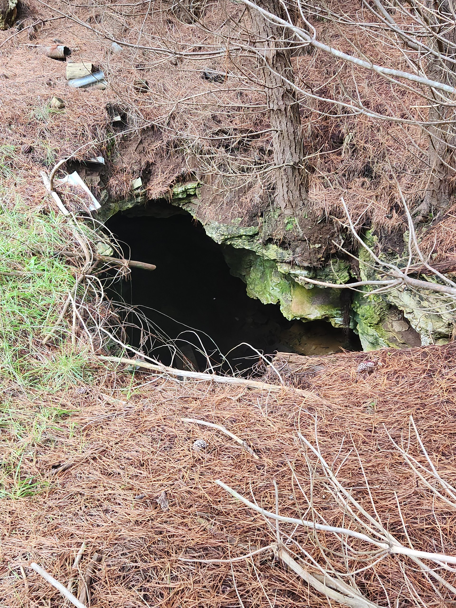
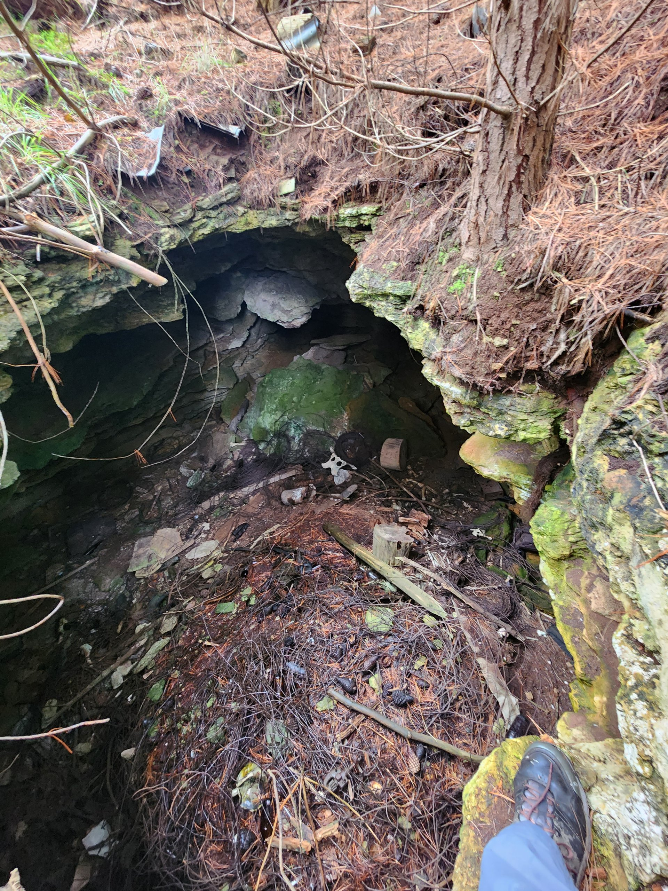
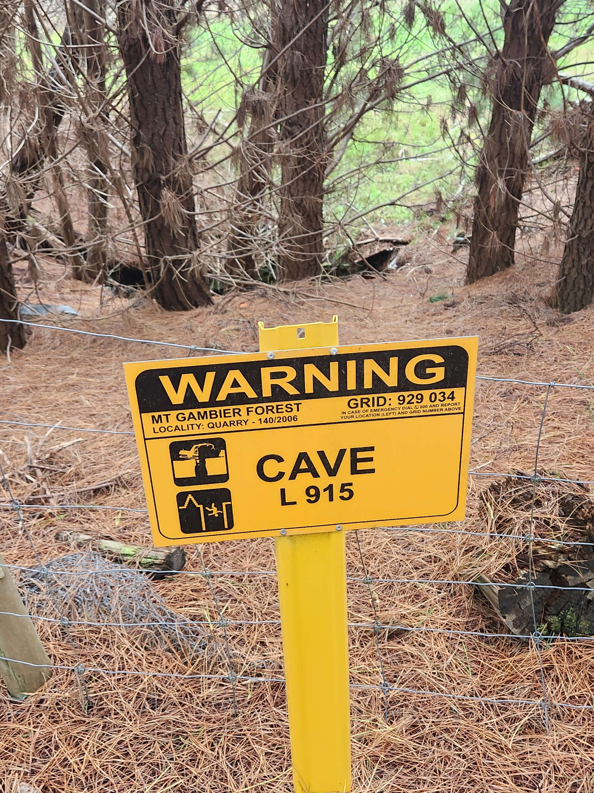

# About

BC: site exists, partially filled with rubbish. Needs ladder or VA to access safely

# Details

## Identification

- **Feature type:** Sinkhole
- **Reference:** L0915
- **Source:** Forestry SA

## Cave and exploration data

- **Exploration potential:** High

## Access and warnings

Forestry

# References

- **Forestry SA:** L0915, Thin Roof: N, Fence: R. Dimensions: about 7m deep. Features: Maidenhair ferns,  most rubbish removed - July '99

## Images
- 
- 
- 
- 
